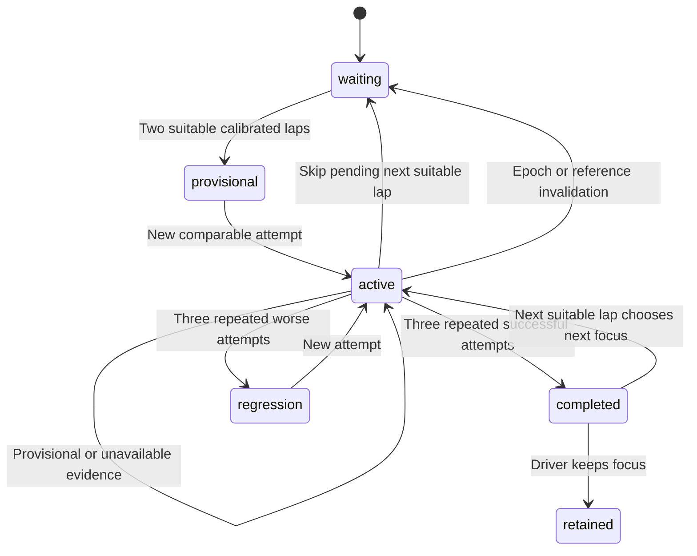

# Sustained focus and attempt contract, #980

Pure serialized state consumes trusted current calibration snapshot, eligible current lap, assessment and original two baseline rows. It owns no I/O/providers. Live service will serialize and bind source/access/epoch before and after calculation.

| Requirement | Production | Positive | Failure | Runtime |
|---|---|---|---|---|
| Balanced/Pace/Consistency | Focus objective and matching calibrated objective | Default Balanced, objective-specific criteria | Unknown objective; changed epoch/objective clears focus | Multi-lap sequence |
| One recurring relevant focus | Candidate rank support then objective relevance then bounded strength | Repeated small issue before large isolated one | Unsupported skill ignored; no geometry general consistency | Real assessment DTO |
| Stable focus | Freeze candidate identity, reference and baseline at selection | Different larger next finding retains focus | Missing/unsuitable/duplicate/out-of-order attempts do not score | Sequence and snapshot comparisons |
| Progress | Three distinct consecutive comparable attempts | Repeated net gain, reduced range, Balanced both | Faster outlier, downstream/exit loss, missing check, zero baseline variation | Numeric sequence |
| Driver overrides | constrain/skip/keep | Skill constraint, next candidate, retained completion | Invalid constraint, old epoch, skipped candidate cannot be auto-reselected | Explicit transition sequence |
| Comparability | Calibration epoch/owner/training/context binding | Same bound evidence accepted | Context/objective/reference changes reset, stale calibration admission denied | Calibration plus focus replay |
| Bounded private state | Compact DTO projection, attempt/ledger/history limits | Snapshots copied, provenance retained | Oversized/untrusted fields, nonfinite derived metrics, budget overflow fail closed | Malformed DTO tests |

States: waiting -> provisional/active -> completed; active may report regression; driver keep yields retained; skip records skipped and chooses next on next usable lap. Epoch invalidation records old focus then returns waiting, never scores old attempt. No model training/causal learning claim.

At selection freeze calibration reference identity and original baseline identity/times. Do not score the selection lap. Section pace checks require identical measured start/end and frozen reference time; recompute numeric net/downstream/exit gates, never trust a prose/result label. Missing focused section cannot be invented. General whole-lap pace uses the original baseline midpoint and states cause unknown.

Consistency uses the original two-lap measured range as stable starting denominator and three-attempt range; meaningful reduction >max(.05s,10% starting range). Zero starting range can maintain repeatability but cannot prove reduction. Pace requires all three gains against the original measured baseline, beyond its screen and with no hidden downstream/exit loss. Balanced requires both. These conservative initial screens describe measured evidence, not optimal targets.

# Objective and attempt examples

Original comparable laps 90/92 seconds retain midpoint 91 and range 2. A frozen 10-second passage includes exit and following section.

- Balanced: 89s lap and 9.8s passage is provisional. A 90s lap with no passage gain blocks success. Three new 89s/9.8s attempts reduce lap range and repeatedly gain through the full passage, so completion records repeated observed improvement.
- Pace: 89/91/89s laps can succeed if all three have a guarded 9.8s passage, despite unchanged whole-lap variation. The specific passage is the stated check; causes elsewhere remain unknown.
- Consistency: 91/91/91s laps reduce range to zero and may complete despite a slower focus passage; reduced variation is the declared goal, not a pace claim.
- Original 90/90s laps and later 90/90/90s show maintained repeatability. They cannot reduce an already zero range.
- A faster corner with 0.3s following loss or 5 km/h exit loss never passes the pace criterion, even if the upstream DTO says provisional_gain.
- Unsuitable/warmup/partial laps retain the focus without a technique score. A missing focused section reports unavailable evidence and cannot be counted as a successful attempt.

## Bounds and ownership

The focus instance belongs to one trusted profile/subject. A changed owner requires
a new instance and clears private state. Missing calibration invalidates the focus
and old control epoch. The caller checks current access and live source before and
after evaluation; no browser may construct calibration snapshots.

Retain at most 12 compact attempts, 128 deduplication entries and 16 transition
summaries. Monotonic lap numbers still reject old laps after deduplication eviction.
Keep at most 128 completed/skipped identities per calibration epoch; never evict
an explicitly dismissed identity to suggest it again. Further skip commands require
an explicit new calibration epoch. Candidate projections accept at most 24 findings,
with bounded strings/evidence and no raw traces or private extra fields.

Completion advances to another observed exercise on the next suitable lap, unless
the driver explicitly keeps the focus. Absent matching skill evidence uses a
labelled general repeatability exercise rather than inventing a skill diagnosis.
The original baseline stays fixed when a new focus begins. The live coordinator
ends the calibration focus before promoting its better personal reference.

A corrected input difference may disappear from the next assessment. Repeated
progress still uses an available check from the same complete section, with the
same frozen reference and measurement window. A different section cannot fill
that gap. A missing check remains unavailable.

## Original progress denominator and reference facts

For a section focus, freeze the original two laps' full-window mean/range,
following-section mean and exit-speed mean. Pace requires repeatable gains
against this original window, with no new following loss or lower exit speed.
Consistency compares the three-attempt window range with the original window
range. General exercises use whole-lap timing/range and explicitly leave causes
unknown. A selected reference remains a separate comparison and cannot redefine
starting progress merely by being slower.

Assessment exposes complete section checks even when an input difference has
vanished or the reference is matched. Checks include the corner-exit station and
absolute downstream timing. Preserve the original measured check and evidence;
a separate reference benchmark identifies the frozen lap/window used by future
attempts. Self-reference fallback never rewrites earlier measured facts.
Skip and changed-skill controls retain the previous result in transition history,
then clear the current success score and review while waiting for a new exercise.

The coordinator calls `Focus.finish()` only after completion and before
`Calibration.end_focus()`. The completed result is retained in history, current
attempts are cleared, and only then may calibration promote a better personal
reference. Driver-retained focus cannot be finished by that automatic transition.
