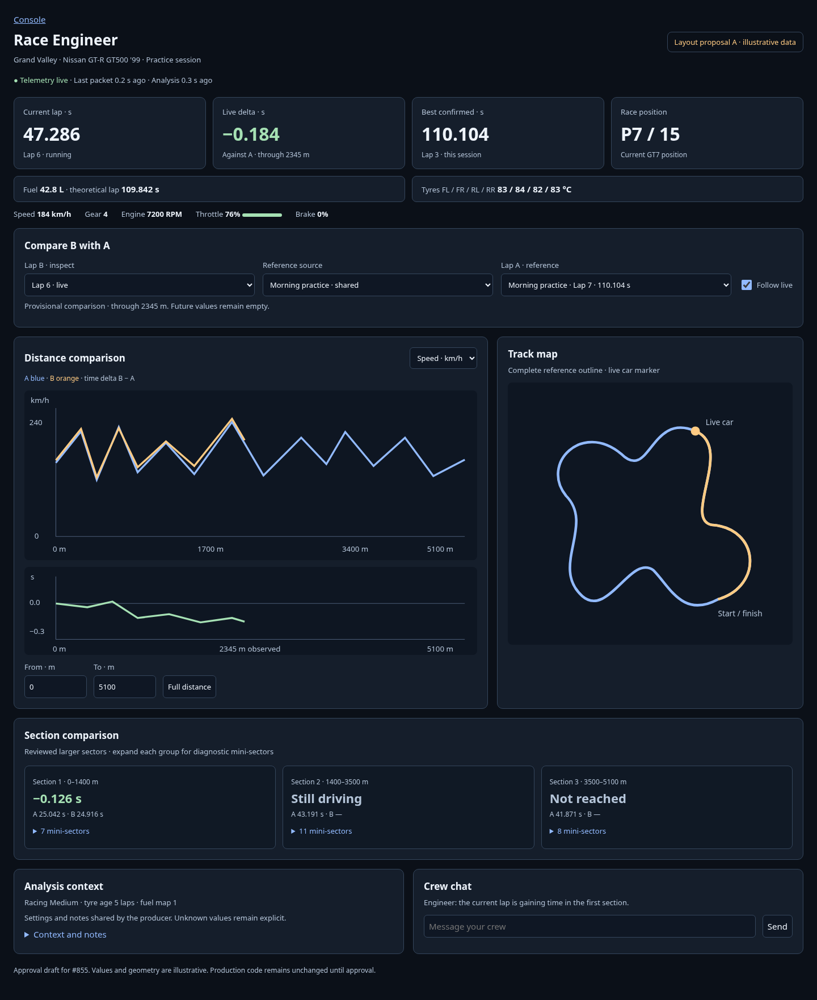
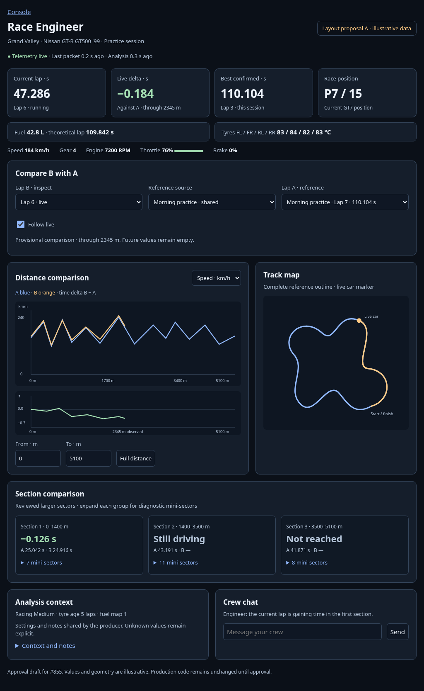
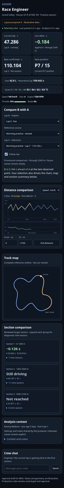

# Race Engineer layout proposal A

Approval artifact for #855 under #850. This draft contains illustrative values
and geometry, not recorded driver data. The production layout is unchanged.

- Headline row: current lap time, live delta, confirmed best, race position.
- Fuel, theoretical time and tyres directly below; compact driving inputs.
- One compare-B-with-A row with source and Follow live.
- Channel and distance controls at the charts; stable map beside them.
- Reviewed larger-sector groups with gain/loss emphasis and expandable mini-sectors.
- Phone keeps comparison feedback, charts, map and section summaries available.
- Context, shared notes and Crew chat follow the analysis.

[Standalone HTML draft](engineer-layout-proposal.html)

## Desktop, 1440 px

## Tablet, 1024 px

## Phone, 390 px

The producer must approve the rendered draft before production implementation.
Further implementation follows the position work in #854. These screenshots
are design evidence; production wiki screenshots are refreshed with the actual UI.
