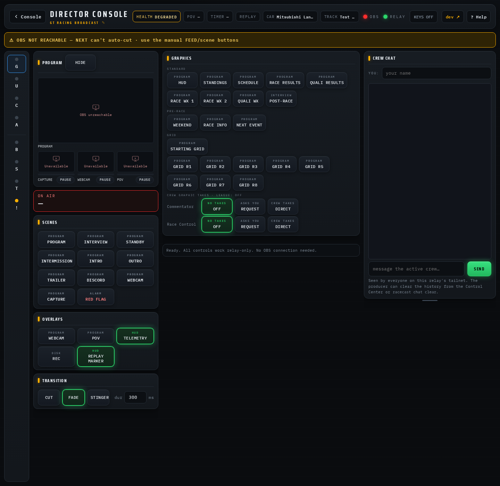
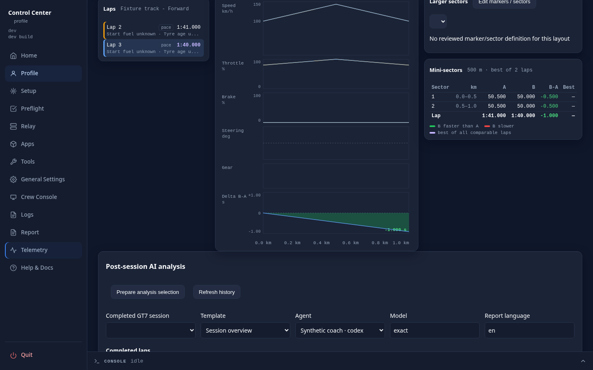
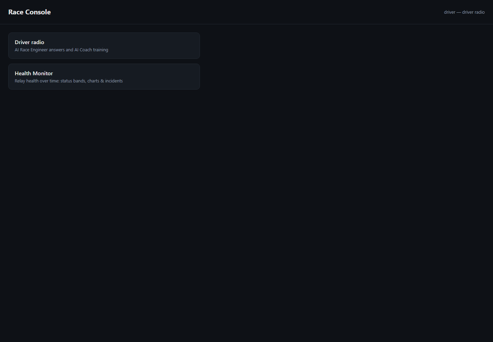
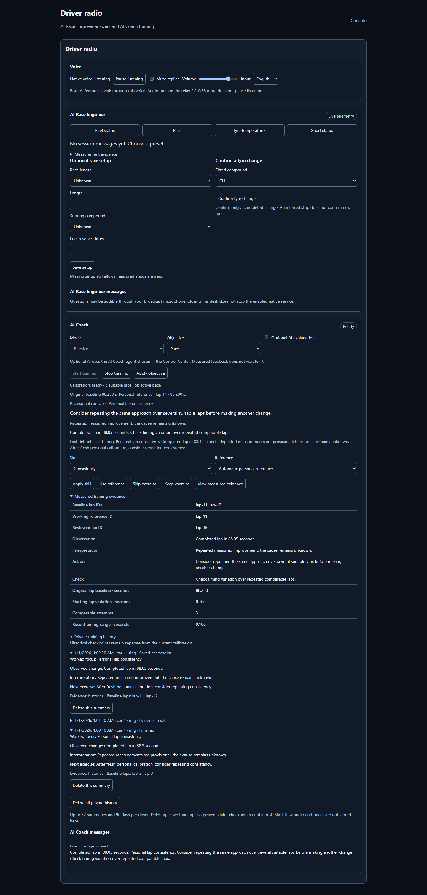
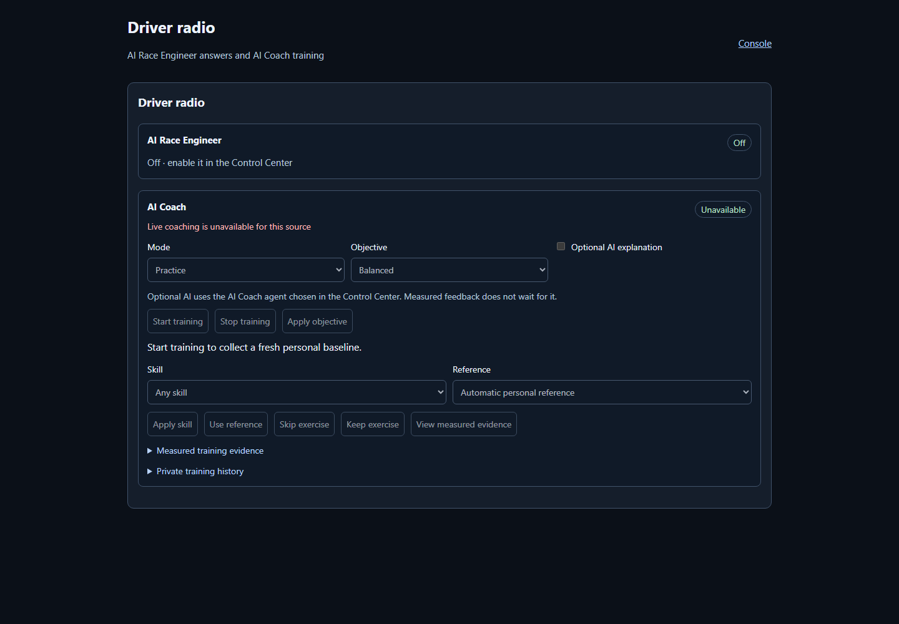

# Driver radio

A Solo POV profile has two separate AI features for its driver:

- **AI Race Engineer**: English fuel, pace, tyre-temperature and short-status
  answers, plus proactive fuel warnings and completed-lap pace notices. It runs
  whenever it is enabled and live telemetry is present. There is no start button.
- **AI Coach**: explicit personal training with one exercise at a time, progress,
  a debrief and a private history. Enabling it does not start training; only
  **Start training** does.

Neither is a Crew role. The human **Race Engineer** (the Crew role and its
read-only `/console/race-engineer` desk) is a different thing and is not changed
by either switch.

## Where each feature appears

| Output | AI Race Engineer | AI Coach |
|---|---|---|
| Text on a second device | **AI Race Engineer** section of the Console driver desk and the Director Panel Solo card: presets, latest answer and its messages | **AI Coach** section of the same views: training controls, focus, review, debrief, private history and its messages |
| Audio | Native voice on the relay PC, when the shared **Voice** settings enable it | The same native voice and the same single playback slot |
| Voice controls | **Voice** row above both sections (pause listening, reply mute, volume, input language), shown while either feature is on | The same row |
| Control Center | **AI Race Engineer** card (switch and agent) | **AI Coach** card (switch and agent) and **AI Coach training** below the settings |
| HUD in OBS | **Race engineer** slot, off until its **Visible** is switched on in the overlay builder | **Coach** slot, off until its **Visible** is switched on |

Every message carries its source, so an engineer answer never appears in the
AI Coach section and a coach review never appears in the AI Race Engineer
section. A message labelled **Feature off** is the hint a switched-off feature
gives when someone asks it something. The relay serves the shared message lane
and the native voice controls while either feature is on, and sends each view
only the messages of the features that are switched on: with the AI Coach alone,
the desk shows the coach messages and the **Voice** row, and no engineer
messages; with the AI Race Engineer alone, no coach messages leave the relay.

## HUD slots

The HUD has two text slots for the broadcast picture, **Race engineer** and
**Coach**. Each is its own slot in the Control Center **Overlay Builder** (scene
**HUD / Program**) that you position and style like any other text slot. By
default both look like the **Race control** banner and sit above it.

- **Race engineer** shows the text of the current AI Race Engineer message: a
  preset answer, a voice-question answer, or a proactive fuel or pace notice. It
  never shows the spoken question or an AI explanation. The slot clears when the
  message expires, is replaced by a newer one, or becomes invalid (another
  session, car or setup, a pause in live telemetry).
- **Coach** shows the latest lap review of the running training as one line,
  `<focus>: <action>`, or the action alone until the training names a focus. It
  stays until the next review replaces it and clears on **Stop training**, when
  the training context becomes invalid, and before the first review. Calibration
  progress and the debrief are not shown.

Both slots start **hidden**: **Visible** is off by default, so nothing reaches the
stream until the producer switches it on for that slot. With **Visible** on, a slot
still hides while it has nothing to show, and it stays empty while its feature is
switched off or on a profile that is not Solo POV. A long line shrinks to fit the
slot (from 28px down to 14px by default; the builder's fit bounds change that).
The relay serves both lines with the rest of the HUD data, so a refreshed OBS
browser source shows the current text again.

## Enable the features

Start the relay for the Solo POV profile, then open **Telemetry** in the Control
Center. **Driver radio setup** has three cards:

- **AI Race Engineer**: **Enable AI Race Engineer** and its own **Optional live AI**
  agent.
- **AI Coach**: **Enable AI Coach** and its own **Optional live AI** agent.
- **Voice**: native voice, microphone override, input language, wake phrase,
  transcription and Google speech. Both features use this one voice
  configuration.

Choose **Save profile radio settings**. The two switches are independent. A
switched-off feature's section in every view shows **Off · enable it in the
Control Center**, while the other feature's section keeps working.

There is no driver list. Anyone signed in to this profile's Console can use an
enabled feature, whatever their Crew role (commentators, Race Control, Race
Engineer desk users and Discord sign-ins included). Console sign-in is still
required for every driver radio page and request. Switching a feature off refuses
its next request and removes its data from open views. The existing Engineer
archive and producer permissions remain separate.

While either feature is on, every signed-in Console shows **Driver radio**. A direct Director Panel visit
uses the same Console identity. Sign in through Console, then choose **Connect
driver radio** in the Solo POV card. Existing Director controls keep working when
radio access is unavailable.

## Use the AI Race Engineer

The four buttons request **Fuel status**, **Pace**, **Tyre temperatures** and
**Short status**. Text appears before optional speech or AI explanation. The desk
adds bounded message history, measurement evidence, optional race length,
starting compound and fuel reserve. Missing setup limits finish estimates and
strategy conclusions; it does not prevent measured status answers.

Confirm a tyre change only after it has happened. An inferred stop does not
confirm a new tyre stint. Slower comparable laps can support conditional tyre
advice, but tyre wear, traffic and weather causes are not directly measured.
Pace comparisons use completed eligible laps and show their sample basis.

If another view changes the setup while you edit it, the save is refused. Reload
the current form, review its values and enter your changes again. Session/context
changes clear obsolete work. Switching the AI Race Engineer off empties its
section in open views and leaves the AI Coach section running.

## Train with the AI Coach

Choose **Practice** or **Time trial**, select **Balanced**, **Consistency** or
**Pace**, then explicitly choose **Start training**. Opening a view does not start
training. Calibration counts suitable completed laps after Start; earlier laps and
the partly driven start lap do not become the new personal baseline.

The view distinguishes the original baseline from the working reference. It shows
one exercise, provisional versus reviewed geometry, repeated progress and measured
lap IDs. A faster lap alone does not establish why it improved. Unsuitable laps
retain the exercise without adding a technique score. **View measured evidence**
shows the observation, interpretation, action and checks behind the current review.

Apply a skill constraint, **Skip exercise** or **Keep exercise** deliberately. A
constraint unsupported by current evidence waits for suitable data. An optional
reference must match current context; shared archives additionally require the
separate Engineer role and producer grant. Replay and stale data are not offered
as current live references or scored as live training.

**Stop training** remains available while another change waits or the displayed
revision has become old. Closing the browser does not stop relay-owned training.
Changed car, track, definition or corrected evidence can reset the comparison basis.
If a form conflicts, reload its current values before applying your draft.

Training explanations use the agent chosen in the **AI Coach** card only when
**Optional AI explanation** is explicitly checked for that training. It defaults
off. Deterministic feedback does not wait for the agent, and private training
history is not uploaded as AI context.

## Private history and the next drive

**Private training history** contains compact checkpoints and end summaries:
worked focus, observed change, interpretation and the next exercise. It keeps the
original provenance and distinguishes provisional results from repeated measured
improvement. Cause remains unknown. A failed final write or interrupted relay
produces a partial summary from the last stored checkpoint.

A Solo POV profile has one driver, so it has one training and one history.
Control Center, native voice and every signed-in Console view show the same
active training and the same history, and any of them can stop it. Histories
that older builds kept per Console identity are merged into the profile's
history once, when the relay starts the coach.

The limit is 32 recent segments and 90 days per profile, pruned on reads and
writes. Raw audio, traces and transcripts are not kept in this journal, and
keeping a recording is not required. **Delete this summary** and **Delete all
private history** affect the profile's history in every view. Deleting active
training also prevents its later checkpoints from restoring that history until
an explicit fresh Start.

A previous skill may be suggested after fresh accepted calibration in a known
compatible car, track, definition and conditions. **Apply suggested skill** is
explicit. Historical times never replace the new baseline. Corrected sources or
unavailable archive permissions remove unproven details from historical views.

## Enable native voice

Native voice runs on the same PC as the relay. The initial topology has the driver
microphone and output on that PC. A phone or another browser can control it and
read text; it does not become a remote microphone or speaker.

1. Install FFmpeg and FFplay on the relay PC. The existing tool setup normally
   provides FFmpeg; ensure FFplay is also available on the executable search path.
2. Explicitly install the pinned local wake and transcription models:
   `racecast radio provision`. Provisioning verifies checksums and the prepared
   phrase fixtures. A relay start downloads nothing.
3. In the **Voice** card of **Driver radio setup**, deliberately enable native voice for the profile.
   It uses the microphone selected in Control Center unless you enter a
   **Microphone override**. On Windows/macOS the override is the native device name; on Linux it
   is the PulseAudio source identifier.
4. Choose a validated prepared wake phrase and English or German input. Output
   remains English. Arbitrary typed wake-model generation is unavailable.
5. Configure the optional speech/transcription services described below. Without
   speech configuration, the same answers remain available as text.

Once enabled, native voice starts with that profile's relay and keeps working
with all browser/Control Center views closed and OBS stopped. **Pause listening**
is temporary. Clearing **Enable native voice** persistently disables it for the
profile. The desk and card also expose reply mute, volume and session input
language. Closing a view does not change any of these native settings.

Say the wake phrase for every new question. You can continue directly into the
question, such as "Hey Jeff, will the fuel last at this pace?" A short context
supports follow-ups such as "And if I stay out one more lap?" Each answer uses
refreshed facts. Vehicle and broadcast-control commands are refused. The initial
version does not listen for spoken interruptions while it plays a reply.

Wake-gated coaching vocabulary is deliberately narrow:

| Request | English | German |
|---|---|---|
| Start / stop | `start training` / `stop training` | `Training starten` / `Training stoppen` |
| Time trial | `start time trial training` | `Zeitfahren starten` |
| Objective | `objective balanced`, `objective consistency`, `objective pace` | `Ziel ausgewogen`, `Ziel Konstanz`, `Ziel Tempo` |
| Skill | `focus on braking` or another supported skill | `Fokus Bremsen` or another supported skill |
| Skip / keep | `skip focus` / `keep focus` | `Übung überspringen` / `Fokus behalten` |
| Current state | `training status`, `current focus`, `training evidence` | `Trainingsstatus`, `aktueller Fokus`, `Trainingsbelege` |

Supported English/German skills are braking/Bremsen, throttle/Gas,
steering/Lenken, gear/Schalten, speed/Geschwindigkeit, line/Linie, pace/Tempo and
consistency/Konstanz. Use `any skill` / `alle Techniken` to remove the constraint. Ambiguous
coaching requests ask for clarification and do not guess an action. Output stays
English and uses the shared radio queue; urgent Engineer output has priority.

OBS software mute does not pause listening. A hardware microphone mute
removes its input signal too. Questions may remain audible through your normal
broadcast microphone. Radio does not alter OBS sources, microphone filters or
routing. Deliberately capture the PC output if you want replies in the broadcast.

## Speech and transcription services

English speech uses Google Cloud Text-to-Speech **en-US-Studio-Q**. Configure the
existing machine setting `RACECAST_GCLOUD_TTS_KEY` and explicitly select Google
speech in the profile's radio setup. Credentials stay on the relay. Only answer
text is sent for synthesis. There is no silent voice substitution.

`racecast radio smoke --allow-cloud` makes two configured synthesis requests and
measures cold, warm and cached latency without playing audio. It incurs normal
provider usage. Run it deliberately; ordinary tests never make paid calls.

Transcription choices are independent:

- **Local Vosk** is the lightweight default after model provisioning. Recognition
  can miss free questions, especially in noise. Repeat the wake and question, or
  use a preset if the transcript is wrong.
- **Local whisper.cpp** uses its separately installed `whisper-cli`. Run
  `racecast radio provision --whisper` to download pinned multilingual tiny
  weights. Optional machine settings `RACECAST_RADIO_WHISPER_EXE` and
  `RACECAST_RADIO_WHISPER_MODEL` select an installed executable/model. Synthetic
  English checks worked with tiny/base; the first German synthetic phrase was
  unreliable. Verify recognition with your own voice before relying on it live.
- **Google Speech** requires explicit profile selection and the separate machine
  key `RACECAST_GCLOUD_STT_KEY`. Only the wake-gated utterance, including at most
  two seconds of pre-roll, is uploaded. Ambient listening is never uploaded
  continuously. There is no automatic local/cloud fallback.

Microphone buffers are bounded to 16 seconds and are not written as raw recordings.
Transcription and synthesis have separate short work budgets. Recognized questions
and answers stay in bounded volatile session history. Session/context changes and
relay shutdown invalidate pending work and old playback.

Optional live AI uses the isolated agent chosen in the feature's own card. Its small fact package
contains the current allowed telemetry and short question context. Busy, missing,
invalid or late AI leaves deterministic text intact. Numerical claims are checked
against supplied facts; optional interpretations remain labelled separately.

## When voice is unavailable

The visible native state distinguishes disabled, paused, listening, transcribing,
responding and error conditions. Missing models, device permissions, unplugged
microphones, failed providers or playback do not remove preset text. The service
retries device/worker failures with bounded backoff. Failed cleanup retains the
old playback slot until termination succeeds, preventing a second output owner.

Shared microphone access with OBS/Discord and real acoustic wake accuracy depend
on the OS, device and environment. Verify them on the producer PC. Synthetic CI
covers the software lifecycle; live microphone capture, paid-service latency and
hardware coexistence are separate deliberate checks.
