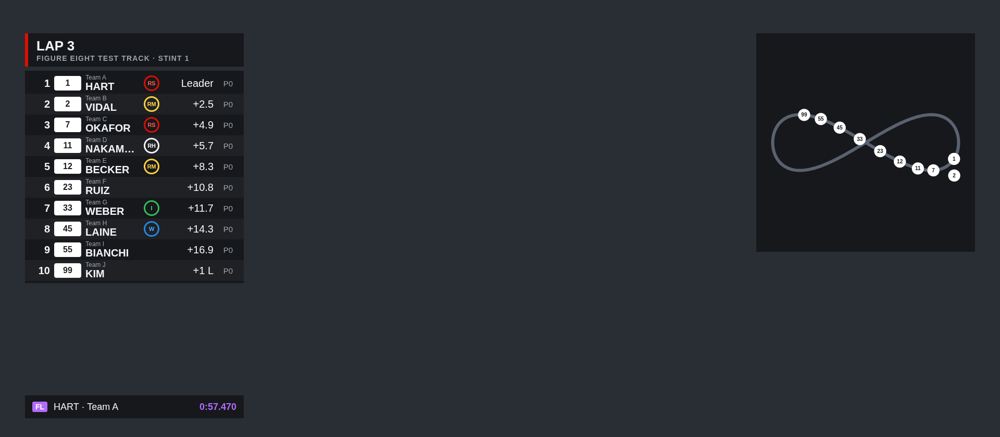

# Driver telemetry: the driver guide

Drivers can send their own GT7 telemetry to the broadcast. A small program, the
**sender**, runs on a device on the same network as the PlayStation, receives the
console's telemetry and passes it to the producer's relay. It sends nothing else, and
it does not change what the PlayStation or your other apps do.

## Get your command

1. Open the invite link the producer shares for the event.
2. Pick your entry and, in an endurance race, your stint or qualifying segment.
3. Type your name and press **Get my sender command**.

The page shows a command with your personal code. The code works for the whole event.
When the producer renews the invite link, open the new link and register again.

## Which setup

GT7 sends telemetry to every device that asks for it, but on one device only one
program can receive it. Pick the line that matches what you already run:

- **Nothing else receives your telemetry:** run the command as shown, on a PC, laptop,
  tablet or phone.
- **A dashboard app on your phone:** run the sender on a second device on the same
  network. It cannot share the phone with the app.
- **SimHub on the same PC:** add `--forward 127.0.0.1:PORT`. The sender then passes every
  packet to that port; point SimHub's GT7 input at it and turn SimHub's own heartbeat off.
- **GT Race Engineer with "Telemetry Forwarding":** let it forward to a port on the same
  device and add `--listen PORT`. The sender then sends no heartbeat of its own.

The sender finds the PlayStation by itself. If it reports "no console found", add
`--console <PlayStation IP>`; the PlayStation's network settings show its IP address.

## Your platform

Every platform needs the same thing from its firewall: **allow inbound UDP 33740** for
the sender (or the `--listen` port). The console sends from a port of its own, so its
packets do not count as an answer to the sender and a firewall drops them by default.

- **Windows.** With Python 3.8 or newer from python.org, download
  `racecast-sender.py` from the invite page and run the Windows Python command (`py
  racecast-sender.py ...`) in a terminal in that folder. Without Python, download the
  Windows program and run the `.\racecast-sender-windows.exe ...` command in its folder.
  The program is not signed: SmartScreen shows
  "Windows protected your PC", choose **More info → Run anyway**. When Windows asks
  whether to allow the program on networks, allow **private networks**.
- **macOS.** Python 3 from python.org with the `python3 racecast-sender.py ...` command,
  or the macOS program: run `chmod +x racecast-sender-macos` once, then the
  `./racecast-sender-macos ...` command. The program is not signed: macOS refuses the
  first start, then open **System Settings → Privacy & Security** and choose **Open
  Anyway**. Allow incoming connections when the firewall asks.
- **Linux.** Run the Python command. With ufw: `sudo ufw allow 33740/udp`.
- **Android (Termux).** Install Termux, run `pkg install python`, download the script
  with `curl -o racecast-sender.py "<script link from the invite page>"` (the quotes
  matter), then run the Python command. Run `termux-wake-lock` first so Android does not
  pause Termux.
- **iPhone and iPad (a-Shell).** Download the script with
  `curl -o racecast-sender.py "<script link>"` and run the Python command. iOS runs a-Shell only in the foreground: keep the screen on,
  a-Shell in front and the device charging.

## While it runs

The sender prints a status line every ten seconds: packets per second received from the
console and batches sent to the relay. It says when the console goes quiet (menus,
replays, network) and when the upload is interrupted, and it catches up after a short
outage. Stop it with Ctrl+C.

The relay accepts one sender per entry in a single-lobby race and two per team in an
endurance race (the driver on track and the one waiting for the next stint). If the
sender says someone else sends for your entry, ask the producer. While the console is
quiet the sender keeps its place with a short message every five seconds.

For other client developers: the ingest is a versioned HTTP contract,
[`src/docs/design/driver-telemetry-ingest.md`](https://github.com/jegr78/gt-racing-broadcast/blob/main/src/docs/design/driver-telemetry-ingest.md).

## Race order and gaps

From the drivers' telemetry the relay computes the race order, the gap to the leader
and the interval to the car ahead. It needs the event's track layout (Control Center
Home, **Track layout**) with a downloaded racing line; without one it shows no distance
and says so. Changing the layout mid-event starts the race over.

- **Distance** counts GT7's lap counter plus the car's position along the racing line.
  GT7 shows lap 0 on the grid. With **Formation lap** on (Home, **Driver race**),
  distance starts when a car crosses the line the second time; off, at the first
  crossing. The crossing times form the starting gaps. Laps driven before the race in
  the same lobby are dropped when GT7 resets the lap counter, and nothing counts while
  the relay is in qualifying mode.
- **Gap and interval** are the time the car ahead needed from the same point. A car a
  full lap or more down shows `+N L`.
- **Box** shows while a car stands off the racing line for a moment. **No data** shows
  while its sender has been quiet for five seconds; the entry keeps its place.
- **Pit stops** count every box stop the car drives out of.
- **Finish after laps**: the leader finishes on completing the lap count on GT7's
  lap counter, lap 1 included, so a formation lap counts as in the lobby's own
  setting; every other car at its next crossing of the line. **Timed**: Race Control or
  the director triggers **Final lap**, and the race ends at the leader's next crossing.
  The race timer never ends a race. **Finish** freezes the order at once. After the
  leader's flag the order is laps first, then who completed them first, so a lapped
  car that takes the flag stays behind a car on the lead lap that is still running.

In an endurance race each stint switch on air opens a window for driver changes. When
the team's car stands in the box and the next driver's car then leaves the box of the
next lobby, the team continues from where the old car stopped. A driver who stays on
for the next stint does the same with one sender. Lap 1 of the new lobby before that
never counts. The lap count applies to the final lobby only and counts that lobby's
laps on GT7's counter, from the car that took over after the last stint switch: the
last row's `Laps` cell of the [Schedule tab](Sheet-Template#schedule-tab), else the
event setting. A lap count set while the final stint is already on air applies at once.

### Dashboard

The relay keeps a viewer version of the race for the broadcast dashboard, the
Commentator Cockpit and later the public live timing page: order, entry number and
colour, driver, the `Cup Team` from the [Configuration tab](Sheet-Template), gaps, status,
pit stops, race laps (in endurance also the laps of the current stint lobby), the last
completed lap time, fuel, each car's position for the track map, the leader's lap
against the lap count (in endurance the final lobby's lap, once the final lobby's car
counts; never past the count after the flag), the remaining time of the race timer and the fastest race lap.
It never carries connection ids, corrections or who made them.

- **Lap times** are timed by the relay between two crossings of the line and taken
  from GT7 only when both agree within a second (3 % on long laps). The formation lap,
  lap 1 of a follow-up lobby and any lap with a start, red flag, change or move in it
  do not count.
- **The fastest race lap** is kept across stints and survives a relay restart on the same
  track layout; the next `event start` or a race reset clears it. A lap faster than the
  line allows at 120 m/s never counts. Race Control and the director can clear or set it
  (`POST /drivers/race/fastest`).
- **Delay**: the event setting holds the dashboard, and the stint it shows, back by up to
  120 seconds to match the commentator feed on air. Race Control and the director keep
  the live race. **Show dashboard**, **Hide dashboard** and the display switches act at
  once, never after the delay.
- **Qualifying**: in qualifying mode the dashboard ranks the running segment by GT7's
  best lap, with the gap to the fastest. A lap set while the sender was live stays on
  the tower when the sender closes or loses its connection, until the relay restarts;
  a best lap faster than the line allows is ignored.

### On air and in the cockpit

- **OBS overlay** `http://127.0.0.1:8088/drivers`: the browser source **Driver
  Dashboard** in the Stint scene (Program in the solo collections). It shows a timing
  tower of up to 15 entries, the lap against the lap count (or the race timer's
  remaining time), the fastest lap and a track map with each car as a numbered dot in
  its entry colour. The value column alternates every 15 seconds between the interval,
  the last lap and the fuel; a car in the box shows `Box`. In qualifying the tower shows
  best lap and gap.
- **On air only when switched on.** The page stays empty until the race settings say
  `visible`; a new install starts off air. The director puts it on air with **Show
  dashboard** in the panel's Driver telemetry section; Race Control cannot, because it
  is a program change.
- **Tyre compound**: GT7 sends none, so Race Control and the director set it per entry
  in the desks' **Tyres** section: Racing Soft `RS` (red), Racing Medium `RM` (yellow),
  Racing Hard `RH` (white), Intermediate `I` (green) or Wet `W` (blue). It stays through
  driver changes and applies to the race and qualifying; the last change wins and the
  desks show who made it. **Show compound** and **Show fuel** switch those two columns
  on the dashboard for every entry; name and number always show. The cockpit always
  shows both.
- **Corrections** from both desks: clear or set the fastest lap, and set or delete an
  entry's qualifying time (**GT7 time** undoes it). Corrections survive a relay restart.
  A race reset clears the fastest lap; qualifying times and tyre compounds stay until
  the next `event start`.
- **Style** it like the HUD: pick **Driver dashboard** in the overlay builder's scene
  selector ([HUD Overlays](HUD-Overlays#driver-dashboard-layout)).
- **Commentator Cockpit**: the **Timing** card shows the same delayed data with every
  column at once.

### Public live timing

Viewers and team mates can follow the race in a browser without the stream. Each event
gets a public timing link, separate from the drivers' invite: `racecast event start`
creates it and `racecast event stop` ends it. The Control Center's Home view shows it
under **Public timing** with **Copy** and **New link**, and both desks show it
next to the invite. From the command line, `racecast event timing` prints it and
`--new` replaces it; the old link then stops working.

The page needs no login and shows timing only: order, number and colour, driver and
team, gaps, last lap, pit stops, the fastest lap, the remaining time, and compound and
fuel as the display switches set them. In qualifying it shows the ranking. It has the
same delay as the broadcast dashboard. Readers can switch columns on and off, and an
activity list notes new fastest laps, red flags and the chequered flag.

All viewers together share an upload budget (`RACECAST_TIMING_BUDGET_KBPS` in the
machine `.env`, default 1000 kbit/s). With more viewers the page refreshes less often,
at least every 30 s, and shows how old its data is; nobody is turned away. At the
default budget that holds roughly 4000 viewers; beyond them the page stays at 30 s and
the upload grows again. Race
Control, the desks and the stream overlay never slow down for it.

### Hosted live timing (optional)

A league can hand the public page to a Cloudflare Worker on the free Workers plan.
The relay then sends one update every 2 s over a single connection, and Cloudflare
serves every viewer, so the viewer count no longer costs upload. Without a timing host
everything stays as above.

Set it up once per league:

1. Create a Cloudflare account and set its workers.dev subdomain once: **Workers &
   Pages**, **Account details**, **Subdomain**.
2. Create an API token under **My Profile**, **API Tokens**, **Create Token**, **Start
   from scratch**, **Account policy**, with **Workers Scripts: Edit** and **Account
   Settings: Read**.
3. Put the account id and the token into the league profile as
   `TIMING_HOST_ACCOUNT_ID` and `TIMING_HOST_API_TOKEN` (Profile view or
   `profile.env`). Treat the token like a password; it travels with `profile export`.
4. Run `racecast timing-host deploy`, or **Deploy** under **Public timing host** in the
   Profile view. It fills in `TIMING_HOST_URL` and `TIMING_HOST_PUBLISH_KEY`. Deploy
   again after a racecast update; `racecast timing-host status` (**Check**) says when
   the code is out of date.

With a host, both pages run side by side. The Home row and the desks show the link to
hand out (hosted by default) with the number of viewers on the host, and the other link
below it. `racecast event timing --serve funnel` (or **Serve Funnel** in the Home row)
switches to the Funnel link and moves the viewers on the hosted page there; it needs
Funnel switched on (`racecast funnel on`). `--serve hosted` moves the Funnel viewers to
the host. If the host itself becomes unreachable, its viewers move to the Funnel page
on their own, as long as Funnel is on. If the relay restarts or its machine drops off,
they stay on the hosted page and see "relay reconnecting".

The free plan allows 100,000 requests a day per Cloudflare account (reset at 00:00
UTC). Each viewer costs two (the page and its live connection); the relay's updates cost
about 2,200 for a 24 h event. That leaves room for roughly 48,000 viewers a day. The Home row shows
an estimate of today's use; it does not count other Workers on the same account, so use
one Cloudflare account per league. Above the limit Cloudflare stops serving the hosted
page; switch to Funnel before that.

### Red flag, rejoin and corrections

- **Red flag** freezes every entry's distance. In the restart lobby each car
  continues from its anchor when it leaves the box; lap 1 there does not count. The
  league's rule (Control Center Home, **Red flag**, or `racecast event race
  --restart`) says whether a restart keeps the gaps or neutralises them: order and
  laps stay, cars on the same lap start level. Race Control or the director can
  switch it for one restart. **Restart released** ends the mode. A car still in the
  lobby it raced in (a red flag pressed by mistake, or a suspension the lobby drove
  through) counts on from where it is; a car in a restart lobby still resumes when it
  leaves the box. A lap count is counted in race distance, so a restart from the box
  does not shift it.
- **Rejoin** (endurance): a team marked for rejoin starts its next stint from the
  leader's distance at the stint switch, so its later departure from the box becomes
  its deficit.
- **Corrections** add or remove metres and pit stops per entry, always with a reason.
  A **change override** makes a team's other sender the active one at once.

Corrections and rejoin marks survive a relay restart; a race reset and the next
`event start` drop them. Every action is logged with who
and when in `runtime/<profile>/driver-race-audit.jsonl`. Race Control and the director
use them from the Race Control desk ([Console](Console)) and the Director Panel
([Director](Director#driver-telemetry)).

The box detection and the lap counter in the pit lane are not yet confirmed against a
recording of real pit stops. The race lives in the relay's memory: a relay restart
starts it over.
