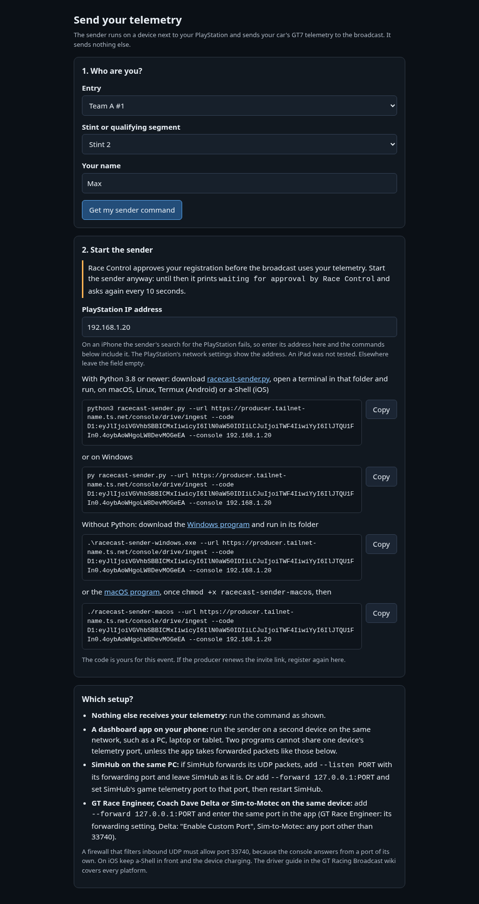
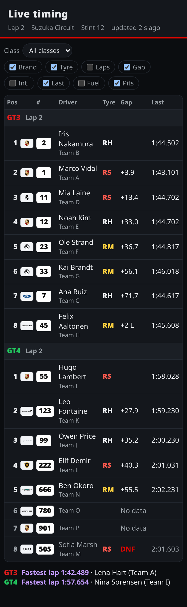
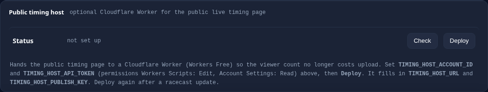

# Driver telemetry: the driver guide

Drivers can send their own GT7 telemetry to the broadcast. A small program, the
**sender**, runs on a device on the same network as the PlayStation, receives the
console's telemetry and passes it to the producer's relay. It sends nothing else, and
it does not change what the PlayStation or your other apps do.

## Get your command

1. Open the invite link the producer shares for the event.
2. Pick your entry and, in an endurance race, your stint or qualifying segment.
3. Type your name (up to 24 letters, digits, spaces, `_ . -`; your PSN Online ID fits) and
   press **Get my sender command**.

The page shows a command with your personal code. Your registration is a request.
Race Control or the director compares it with the car in the GT7 lobby and approves it,
and only then does the relay use your telemetry. Start the sender right away anyway.
Until the approval it prints `waiting for approval by Race Control` and asks again every
ten seconds. Once approved, it says so and starts sending. Race Control may correct your
name, entry or stint when it approves. A rejected registration stops working, and the
sender then says to register again. If you register twice, Race Control sees both
requests marked as duplicates and approves the one it trusts, so keep using the newest
code and tell Race Control.

The code works for the whole event once approved, also after a relay restart. When the
producer renews the invite link, open the new link and register again. Every approval
starts over.

## Which setup

GT7 sends telemetry to every device that asks for it, but on one device only one
program can receive it. Pick the line that matches what you already run:

- **Nothing else receives your telemetry:** run the command as shown, on a PC, laptop,
  tablet or phone.
- **A dashboard app on your phone:** run the sender on a second device on the same
  network. It cannot share the phone with the app.
- **SimHub on the same PC:** add `--forward 127.0.0.1:PORT`. The sender then passes every
  packet to that port; point SimHub's GT7 input at it and turn SimHub's own heartbeat off.
- **GT Race Engineer with "Telemetry Forwarding":** let it forward to a port on the same
  device and add `--listen PORT`. The sender then sends no heartbeat of its own.

The sender finds the PlayStation by itself. If it reports "no console found", add
`--console <PlayStation IP>`; the PlayStation's network settings show its IP address.

## Your platform

Every platform needs the same thing from its firewall: **allow inbound UDP 33740** for
the sender (or the `--listen` port). The console sends from a port of its own, so its
packets do not count as an answer to the sender and a firewall drops them by default.

- **Windows.** With Python 3.8 or newer from python.org, download
  `racecast-sender.py` from the invite page and run the Windows Python command (`py
  racecast-sender.py ...`) in a terminal in that folder. Without Python, download the
  Windows program and run the `.\racecast-sender-windows.exe ...` command in its folder.
  The program is not signed: SmartScreen shows
  "Windows protected your PC", choose **More info → Run anyway**. When Windows asks
  whether to allow the program on networks, allow **private networks**.
- **macOS.** Python 3 from python.org with the `python3 racecast-sender.py ...` command,
  or the macOS program: run `chmod +x racecast-sender-macos` once, then the
  `./racecast-sender-macos ...` command. The program is not signed: macOS refuses the
  first start, then open **System Settings → Privacy & Security** and choose **Open
  Anyway**. Allow incoming connections when the firewall asks.
- **Linux.** Run the Python command. With ufw: `sudo ufw allow 33740/udp`.
- **Android (Termux).** Install Termux, run `pkg install python`, download the script
  with `curl -o racecast-sender.py "<script link from the invite page>"` (the quotes
  matter), then run the Python command. Run `termux-wake-lock` first so Android does not
  pause Termux.
- **iPhone and iPad (a-Shell).** Download the script with
  `curl -o racecast-sender.py "<script link>"` and run the Python command. iOS runs a-Shell only in the foreground: keep the screen on,
  a-Shell in front and the device charging.

## While it runs

The sender prints a status line every ten seconds: packets per second received from the
console and batches sent to the relay. It says when the console goes quiet (menus,
replays, network) and when the upload is interrupted, and it catches up after a short
outage. Stop it with Ctrl+C.

The relay accepts one sender per entry in a single-lobby race and two per team in an
endurance race (the driver on track and the one waiting for the next stint). If the
sender says someone else sends for your entry, ask the producer. While the console is
quiet the sender keeps its place with a short message every five seconds.

### Approving drivers

This part is for Race Control and the director. Every registration lands as a request
under **Driver requests** at the top of the Driver telemetry card, on the Race Control
desk and in the Director Panel alike. A request shows only what the driver typed and
when: name, entry and stint. It shows no telemetry, so match it by eye against the car
in the GT7 lobby.

- **Approve** takes the request with the name, entry and stint in its fields, so fix a
  typo or a wrong team there first. A corrected request shows what was registered.
- **Reject** takes two presses and revokes the code for good. The sender is refused at
  once, also while it is sending.
- A **duplicate** pill marks requests with the same name, entry and stint. Someone may
  have registered in another driver's name, or the driver registered twice. Approve only
  the one the driver confirms, for example by the registration time.
- **Reject all waiting** shows from two waiting requests and rejects every one of them,
  for example after the invite link leaked. Approved drivers keep their approval. If
  requests keep coming, renew the invite link: every code and request of the old one
  ends, and the drivers register again on the new link.
- Approved drivers sit under **Approved drivers**. **Correct** opens the same fields to
  change the name, team or stint later, and **Reject** revokes the code. **Move** in the
  Senders table changes the team the same way.

Each device that registers keeps at most three waiting requests per entry and stint
and eight in all. A further registration from it drops its own oldest waiting request,
never someone else's, so a flood from one device cannot push out a real driver. A
sender whose request was dropped says so once and stops; register again. A
device can register at most 30 times a minute; beyond that the invite page asks it to
try again in a minute. The relay holds at most 200 waiting requests. A new registration
beyond that drops the oldest waiting request of the device that holds the most, so a
newcomer always lands and a flood displaces only itself.

A rejection stops new data at once. It does not erase what the driver sent before, which
stays in the race and the recording. A rejected driver can no longer be moved or set as
the active car of a change.

Until a request is approved, nothing of that driver reaches the race, the recording,
the dashboard or the public timing. Readiness shows a waiting driver as *pending*, and
the Senders table lists it with a *pending* pill. Every decision is logged with the
person's name and the time in `driver-race-audit.jsonl`. The same applies to
single-lobby and endurance races.

For other client developers: the ingest is a versioned HTTP contract,
[`src/docs/design/driver-telemetry-ingest.md`](https://github.com/jegr78/gt-racing-broadcast/blob/main/src/docs/design/driver-telemetry-ingest.md).

## Race order and gaps

From the drivers' telemetry the relay computes the race order, the gap to the leader
and the interval to the car ahead. It needs the event's track layout (Control Center
Home, **Track layout**) with a downloaded racing line; without one it shows no distance
and says so. Changing the layout mid-event starts the race over.

- **Distance** counts GT7's lap counter plus the car's position along the racing line.
  GT7 shows lap 0 on the grid. With **Formation lap** on (Home, **Driver race**),
  distance starts when a car crosses the line the second time; off, at the first
  crossing. The crossing times form the starting gaps. Laps driven before the race in
  the same lobby are dropped when GT7 resets the lap counter, and nothing counts while
  the relay is in qualifying mode.
- **Gap and interval** are the time the car ahead needed from the same point. A car a
  full lap or more down shows `+N L`. Senders post a moment apart, so the order and the
  intervals compare the cars where they were at the older of their last samples (up to
  one second back): a fresher sample never ranks a car ahead of one it trails. When a
  sender stops outright while its car is moving, the car keeps its distance to the
  running car just ahead, or just behind when it leads, and its last gap until it
  shows **No data** five seconds later. A car that stood still or in the box when its
  sender stopped keeps its last distance, so the field passes it.
- **Timing tower** (the on-air `drivers.html`): the gap column shows the gap to the leader. The desks show exact gaps for lapped cars too, as `+1 L · 1:02.5`, also for a car many laps down: the relay keeps the last ten minutes at full rate and everything older at one point per second, up to 24 hours. The public timing page and the cockpit are unchanged, and exact gaps never reach the public view.
- **Box** shows while a car stands off the racing line for a moment. **No data** shows
  while its sender has been quiet for five seconds. The entry keeps its last distance,
  so the running cars pass it and it sinks down the order; an **estimate** keeps it
  where Race Control places it (see below). Once Race
  Control confirms the silence as a disconnect, every screen shows **DC** instead (desks,
  tower, cockpit, public timing page, the recording and its frozen standings), until the
  car sends data again. A car Race Control placed with an **estimate** shows **EST**
  instead of either (see below).
- **No sender**: every entry of the Configuration roster stands in the order from the
  start. One whose driver never ran a sender sits at the end with no gap: **No sender**
  on the desks, **No data** on the tower, the cockpit and the public timing page. A
  sender that connects later takes the entry over. Race Control can place such a car
  with an estimate and give it a driver name (see below); without a name the screens
  show the team.
- **Driver name**: Race Control and the director can change the name every screen shows
  for any driver, also one with a sender, to fix a questionable name. Pick the entry and
  the driver (the one in the car is preselected; "(no sender)" for an entry without
  one), type the name and press **Set name**; **Clear name** removes it. The change
  belongs to that driver of that entry, so the next driver of the same car keeps their
  own name. The desk lists every active change. Names follow the sender rule.
- **Long names**: a screen that shows a full name shows it whole when it fits, else the
  first name as an initial (`A. Fitzgerald`), else cut with `…`; a one-word ID (a PSN
  Online ID) is cut directly. The timing tower shows the surname only, cut with `…`.
- **DNF**: Race Control or the director retire a car on the desk (**Retire (DNF)**, two
  clicks). It stops counting, drops below every running car and shows **DNF** on every
  screen, the recording and its CSV included; its dot leaves the track map. Several
  retired cars rank by the distance they covered. A retired car raises no disconnect
  event, ends its estimate and cannot be an estimate's reference; an estimate that
  followed it ends too, so Race Control attaches that car to another one. **Undo DNF** takes
  back a mis-press: the car counts on from its last distance.
- **Pit stops** count every box stop the car drives out of. In an endurance race the
  driver change at a stint switch counts as one pit stop too: the team's car that
  leaves the next lobby's box and takes over adds one, whether a new driver takes
  over, the driver stays on or the team rejoins. A **change override** after a stint
  switch counts that team's driver change once. A team counts at most one pit stop
  per stint switch, a box stop inside the change window included. The box exit of
  a restart lobby after a red flag adds none. The count is an estimate:
  the relay sees a stop as standing off the racing line, so a car beached beside the
  track or stopped there under a red flag counts as a pit stop too. The desks' `Pits`
  column says so on hover; correct a wrong count with the pit stop correction.
- **Finish after laps**: in a single lobby the leader finishes on completing the lap
  count on GT7's lap counter, lap 1 included, so a formation lap counts as in the
  lobby's own setting; every other car at its next crossing of the line. **Timed**: Race
  Control or the director triggers **Final lap**, and the race ends at the leader's next
  crossing. An endurance final lobby ends on the road, see below. Each crossing is
  timed between the car's two samples around the line, so a car that crosses right
  after the flag finishes there even when its data reached the relay before the
  leader's. The race timer never ends a race. **Finish** freezes the order at once. After the
  leader's flag the order is laps first, then who completed them first, so a lapped
  car that takes the flag stays behind a car on the lead lap that is still running.
  Cars still running on the same lap keep following the road until each finishes,
  compared at one moment as while racing.
  No car shows more laps than the leader had when the flag fell, and a finished car's
  gap is the time it completed that many laps after the car ahead. A finished car with
  fewer laps than the car it is compared with reads lapped (`+1 L`).

In an endurance race each stint switch on air opens a window for driver changes. When
the team's car stands in the box and the next driver's car then leaves the box of the
next lobby, the team continues from where the old car stopped. A driver who stays on
for the next stint does the same with one sender. Lap 1 of the new lobby before that
never counts. The lap count applies to the final lobby only and counts that lobby's
laps on GT7's counter, from the car that took over after the last stint switch: the
last row's `Laps` cell of the [Schedule tab](Sheet-Template#schedule-tab), else the
event setting. A lap count set while the final stint is already on air applies at once.
The final lobby's flag follows the road, as in GT7: the first of its cars to complete
the count takes it, or after **Final lap** the first car to cross the line on the
lobby's leading lap, even when another car leads in race distance. Every other car
finishes at its next crossing, a car a lap down on the road too, and the order after
the flag stays laps first, then who completed them first.

The header's lap (tower, desks, cockpit, public page) is the leader's running race lap:
the race laps really driven plus one, the formation lap excluded, across every stint, so
it is the desk's `Laps` of the leader plus one. A lap count shows in race laps too: in a
single lobby the count less the formation lap, in the final lobby the race laps the
leader will have completed when its lobby counter passes the count, which is where the
flag falls. A count of 20 with a formation lap therefore reads `/ 19`; the desk's lap
count, the class lap inputs and the Schedule `Laps` cells stay GT7 counts. The header never
reads a lap past the count, and once the leader has taken the flag it reads the leader's
race laps, also in a timed race. GT7's own lap of the lobby on
air (**Lobby lap**, the lobby's counter on the road) shows only to the crew: next to the
race lap on the Race Control and director desks and in the cockpit's Timing card. The
tower, the public timing page and the league timing host never carry it.

### Classes

A league that runs several car classes in one lobby names each entry's class in the
`Class` column of the [Configuration tab](Sheet-Template#configuration-tab), with an
optional `Class Color`. With at least two named classes every screen ranks the cars
within their class. With one class or none everything stays as described above. Entries
with an empty `Class` cell form a group at the end, labelled **Unclassed** everywhere
except on the tower.

- **Order**: the relay keeps one overall order, and it decides when each car takes the
  flag. Each car also gets its class position, the gap to its class leader and the
  interval to the class car ahead, from the same timing. A car lapped by a faster class
  is not lapped in its own. The class of the overall leader comes first, the others
  follow by the best position each holds.
- **Lap count per class**: the first class takes the lap count above. The first class is
  the first named class in the current overall order (an unclassed leader does not
  count), so the count can move to another class during the race. For
  every other class Race Control or the director type the count into the desk's **Class
  laps** row (1 to 999, empty clears it). It belongs to the stint on air, shows in the
  class header and never finishes a car. It shows only while the overall count shows, so
  never in a timed race, and in an endurance event only once the final lobby's cars are
  on the line: it belongs to the final lobby's row. An optional Schedule column
  `Laps <Class>` fills it when that row goes on air, unless the desk already holds a
  value or cleared it for that stint. Like the overall count it is GT7's lobby count and
  shows converted to race laps for the class leader. Until a count shows, the header shows the class
  leader's lap only. Once the overall leader has taken the flag, the class header on the
  tower, the desks, the public page and the cockpit never reads a lap past the class
  count, the same rule as the overall lap.
- **Fastest lap**: the relay keeps one per class next to the overall one. On the desk's
  fastest lap form a class picked in the class selector narrows **Clear fastest lap**
  and **Set fastest lap** to that class's lap; the overall lap stays. A race reset
  clears them all.
- **Timing tower**: each class sits under a header with its name in the class colour and
  its leader's lap against the class lap count. The rows show class position, gap and
  interval. When all classes fit in the tower's rows, headers included, the tower shows them
  together and the fastest lap box cycles through the classes every 15 seconds. When
  they do not fit, the tower shows one class per page for one gap and one interval
  phase (30 seconds), and the box shows the fastest lap of that page's class. A class
  with more cars than the tower has rows below its header shows its first cars (19 in
  the default 20 rows).
- **Track map**: each dot keeps its entry colour inside a ring in the class colour. An
  estimate's dashed amber ring replaces it.
- **Public timing page, desks and cockpit** group the same way with a coloured header
  per class. The public page lists each class's fastest lap and adds a filter (all
  classes or one), kept per browser. A [timing host](#hosted-live-timing-optional)
  deployed before classes existed shows them only after a redeploy. The
  desks show the class position, with the overall position on hover. A car lapped
  within its class reads `+1 L · 1:02.5` on the desks, the exact time to its class
  leader, like the overall gap outside class mode. Its interval to the class car ahead
  keeps its time too, also a lap down. After the flag the class gaps follow the overall
  rule: a car that finished with fewer laps than its class leader reads lapped, even
  when the class count keeps the class header below its laps. An estimated car's class times come from the
  overall gaps, so its EST mark applies there as well. The public page and the cockpit
  show the laps only.
- **Recording**: samples carry each car's class and class position, and the frozen
  standings page groups by class with the class gaps, a car lapped in its class with
  the exact time and interval as on the desks. The CSV adds `class` and
  `class_pos` columns only when the recording holds samples from class mode.

### Dashboard

The relay keeps a viewer version of the race for the broadcast dashboard, the
Commentator Cockpit and later the public live timing page: order, entry number and
colour, driver, the `Cup Team` from the [Configuration tab](Sheet-Template), gaps, status,
pit stops, race laps (in endurance also the laps of the current stint lobby), the last
completed lap time, fuel, each car's position for the track map, the leader's race lap
against the lap count in race laps (in endurance once the final lobby's car counts; never
past the count), the remaining time of the race timer and the fastest race lap.
It never carries connection ids, corrections or who made them.

- **Lap times** are timed by the relay between two crossings of the line and taken
  from GT7 only when both agree within a second (3 % on long laps). The formation lap,
  lap 1 of a follow-up lobby and any lap with a start, red flag, change or move in it
  do not count.
- **The fastest race lap** is kept across stints and survives a relay restart on the same
  track layout; the next `event start` or a race reset clears it. A lap faster than the
  line allows at 120 m/s never counts. Race Control and the director can clear or set it
  (`POST /drivers/race/fastest`, with an optional `class` for one class's lap).
- **Delay**: the event setting holds the dashboard, and the stint it shows, back by up to
  120 seconds to match the commentator feed on air. Race Control and the director keep
  the live race. **Show dashboard**, **Hide dashboard** and the display switches act at
  once, never after the delay.
- **Qualifying**: in qualifying mode the dashboard ranks the running segment by GT7's
  best lap. Each row carries the best lap, the gap to P1, the interval to the car
  ahead (both from the best laps) and the last lap GT7 reported. A best or last lap set
  while the sender was live stays when the sender closes, loses its connection or
  starts a new GT7 session, until the relay restarts; a lap faster than the line allows
  is ignored. With [classes](#classes) each class ranks on its own: class position,
  gap and interval within the class. Qualifying has no race laps: the header names the
  segment and, with the race timer set, the remaining time. There is no fastest lap in
  qualifying: the best lap column holds each driver's best.

### On air and in the cockpit

- **OBS overlay** `http://127.0.0.1:8088/drivers`: the browser source **Driver
  Dashboard** in the Stint scene (Program in the solo collections). It shows a timing
  tower of up to 20 entries (see **Tower rows** below), the lap against the lap count (or the race timer's
  remaining time), the fastest lap and a track map with each car as a numbered dot in
  its entry colour. Dots sit on the racing line; in a close pack a dot slides back
  along the line to stay readable, never past the car behind, and otherwise lies under
  the dot ahead. The value column switches every 15 seconds between the gap to the
  leader and the interval to the car ahead, and a white badge on the header's lap line,
  right above the value column, names the current one: `GAP TO LEADER` or `INTERVAL`. On class pages
  the gap is to the class leader. The badge is `#dd-phase` with `data-phase="gap"` or
  `"interval"`, so a league's overlay CSS can restyle each phase. When a car completes a
  lap, its row shows the new lap time for 5 seconds, purple if it is the fastest lap of the race, then returns to the
  gap; a lap that does not count shows nothing. The seconds are a league setting
  (Control Center Home, **Lap time**, or `racecast event race --last-lap-seconds N`,
  1 to 30) that the relay applies at once. A reloaded overlay does not replay the laps
  it already had. A car in the box shows `Box`. Right of the tyre ring a bar
  and a percentage show each car's fuel (GT7 reports the tank in percent); both turn
  amber at 10 % or less, and a car without data shows none. A car that took the
  chequered flag shows a flag in place of ring and fuel, and its final gap.
- **Qualifying on the tower**: the best lap has a column of its own, empty until the
  entry's first lap, P1's in purple. P1's value cell reads `Pole` (with classes each
  class's P1). For the others the value column switches every 15 seconds between
  the gap to P1 and the interval to the car ahead, and the badge reads `GAP TO P1` or
  `INTERVAL` (`data-phase` `gap` or `interval` as in the race). A completed lap shows for
  the league's lap time seconds: purple when it is P1's best lap (in class mode its
  class's P1), green when it is the driver's own best, white otherwise; a lap faster
  than the line allows shows nothing. With classes the tower pages and groups as in
  the race. The fastest lap box, fuel and pit stops do not show in qualifying.
- **Brand logos**: between position and number each entry shows the logo of its
  Configuration tab brand, on a light plate. The logo is the HUD's PNG: the league's
  override in `runtime/<profile>/brands/<key>.png` first, then the bundled one. An entry
  without a brand, or whose brand has no PNG, shows an empty cell. The overlay builder's
  **Brand logos** switch on the Timing tower hides the column and the rows close up; it
  is on by default. The desks, the cockpit and the public timing page always show the
  logos (the public page lets each reader fold them away like any column).
- **Tower rows**: without a height of its own the tower grows down the page, one row
  per car, and the fastest lap box follows 16 px under its last row. On 1080p it holds
  up to 20 rows, so the fastest lap box keeps a 64 px bottom margin. The fastest lap box
  follows only while it sits under the tower; moved elsewhere in the overlay builder it
  stays put, and the tower may reach the bottom margin (21 rows). Set the Timing tower's
  height in the builder (Driver dashboard scene) and the tower holds the rows that height
  fits, never less than 5, and the fastest lap box stays where the layout puts it. A
  height up to 128 px, the builder's sample tower, counts as no height, so an untouched
  Save, or a layout saved by an older version, keeps the growing tower. A class header
  takes one row, so on a paged class tower the fastest lap box moves with each page. The
  page measures on every update; a new layout applies once **Apply in OBS** reloads it.
- **On air only when switched on.** The page stays empty until the race settings say
  `visible`; a new install starts off air. The director puts it on air with **Show
  dashboard** in the panel's Driver telemetry section; Race Control cannot, because it
  is a program change.
- **Tyre compound**: GT7 sends none, so Race Control and the director set it per entry
  in the desks' **Tyres** section: Racing Soft `RS` (red), Racing Medium `RM` (yellow),
  Racing Hard `RH` (white), Intermediate `I` (green) or Wet `W` (blue). It stays through
  driver changes and applies to the race and qualifying; the last change wins and the
  desks show who made it. **Show compound** and **Show fuel** switch those two columns
  on the on-air dashboard for every entry; name and number always show. The cockpit and
  the public timing page always show both; both mark a finished car with a chequered
  flag next to its final gap, which stays when the car parks or its sender goes quiet.
- **Corrections** from both desks: clear or set the fastest lap, and set or delete an
  entry's qualifying time (**GT7 time** undoes it). Corrections survive a relay restart.
  A race reset clears the fastest lap; qualifying times and tyre compounds stay until
  the next `event start`.
- **Style** it like the HUD: pick **Driver dashboard** in the overlay builder's scene
  selector ([HUD Overlays](HUD-Overlays#driver-dashboard-layout)).
- **Commentator Cockpit**: the **Timing** card shows the same delayed data with every
  column at once, logos included; in qualifying best lap, gap, interval and last lap,
  per class with classes. The desks show the same columns live, without the delay.

### Public live timing

Viewers and team mates can follow the race in a browser without the stream. Each event
gets a public timing link, separate from the drivers' invite: `racecast event start`
creates it and `racecast event stop` ends it. The Control Center's Home view shows it
under **Public timing** with **Copy** and **New link**, and both desks show it
next to the invite. From the command line, `racecast event timing` prints it and
`--new` replaces it; the old link then stops working.

The page needs no login and shows timing only: order, brand logo, number and colour,
driver and team, gaps, last lap, pit stops, the fastest lap, the remaining time, and compound and
fuel as the display switches set them. In qualifying it shows best lap, gap to P1,
interval and last lap, grouped by class with the class filter as in the race; the best
lap column always shows and P1 reads `Pole`. Neither the page nor its activity list
shows a fastest lap in qualifying. A [timing host](#hosted-live-timing-optional) deployed before
these columns existed shows them only after a redeploy. It has the
same delay as the broadcast dashboard. Readers can switch columns on and off, and an
activity list notes new fastest laps, red flags and the chequered flag.

All viewers together share an upload budget (`RACECAST_TIMING_BUDGET_KBPS` in the
machine `.env`, default 1000 kbit/s). With more viewers the page refreshes less often,
at least every 30 s, and shows how old its data is; nobody is turned away. At the
default budget that holds roughly 4000 viewers; beyond them the page stays at 30 s and
the upload grows again. Race
Control, the desks and the stream overlay never slow down for it. The brand logos are
not part of the refresh budget: each viewer loads each logo once and its browser keeps it
for a day. The relay holds the logo uploads to the same rate, so a crowd arriving at once
gets its logos over the following minutes while the timing itself stays current.

### Hosted live timing (optional)

A league can hand the public page to a Cloudflare Worker on the free Workers plan.
The relay then sends one update every 2 s over a single connection, and Cloudflare
serves every viewer, so the viewer count no longer costs upload. Without a timing host
everything stays as above.

Set it up once per league:

1. Create a Cloudflare account and set its workers.dev subdomain once: **Workers &
   Pages**, **Account details**, **Subdomain**.
2. Create an API token under **My Profile**, **API Tokens**, **Create Token**, **Start
   from scratch**, **Account policy**, with **Workers Scripts: Edit** and **Account
   Settings: Read**.
3. Put the account id and the token into the league profile as
   `TIMING_HOST_ACCOUNT_ID` and `TIMING_HOST_API_TOKEN` (Profile view or
   `profile.env`). Treat the token like a password; it travels with `profile export`.
4. Run `racecast timing-host deploy`, or **Deploy** under **Public timing host** in the
   Profile view. It fills in `TIMING_HOST_URL` and `TIMING_HOST_PUBLISH_KEY`. Deploy
   again after a racecast update; `racecast timing-host status` (**Check**) says when
   the code is out of date.

With a host, both pages run side by side. The Home row and the desks show the link to
hand out (hosted by default) with the number of viewers on the host, and the other link
below it. `racecast event timing --serve funnel` (or **Serve Funnel** in the Home row)
switches to the Funnel link and moves the viewers on the hosted page there; it needs
Funnel switched on (`racecast funnel on`). `--serve hosted` moves the Funnel viewers to
the host. Switching back to `hosted` brings the moved viewers back. If the host itself
becomes unreachable, its viewers move to the Funnel page on their own after about 12 s,
as long as Funnel is on, and return a minute later once the host serves again. If the
relay restarts or its machine drops off, they stay on the hosted page and see "relay
reconnecting". A hosted page that cannot reach its link for a while says "timing link
unavailable" and stops trying after 30 minutes.

The free plan allows 100,000 requests a day per Cloudflare account (reset at 00:00
UTC). Each viewer costs two (the page and its live connection); the relay's updates cost
about 2,200 for a 24 h event. That leaves room for roughly 48,000 viewers a day. The
brand logos cost nothing extra: the relay sends them to the host once per connection, and
the host hands them to each viewer over the live connection, so the hosted page shows the
same logos as Funnel. A host deployed before brand logos existed shows none until
`racecast timing-host deploy` runs again (**Check** says it is out of date). The Home row and
the desks show an estimate of today's use. It includes earlier timing links of the same day,
but starts again at 0 after a relay restart, and it does not count other Workers on the same
account, so use one Cloudflare account per league. Above the limit Cloudflare stops serving
the hosted page. From about 90 % of the limit by that estimate the relay keeps Funnel viewers
on Funnel and moves the hosted viewers there (when Funnel is on); the Home row and the desks
then say "quota nearly used: viewers stay on Funnel". Only the next UTC day lifts it.

### Red flag, rejoin and corrections

- **Red flag** freezes every entry's distance. In the restart lobby each car
  continues from its anchor when it leaves the box; lap 1 there does not count. The
  league's rule (Control Center Home, **Red flag**, or `racecast event race
  --restart`) says whether a restart keeps the gaps or neutralises them.
  - **Keep** is a release staggered by the gaps: Race Control releases each car from
    the restart lobby's box its frozen gap after the leader. Every car starts from
    the leader's frozen distance (an estimated leader's too), a car laps down that many whole laps behind it, so
    its lap count stays right. The gap after the restart is the release delay. A
    lapped car's exact time is its release delay plus the leader's last lap before
    the red flag, and its own way out of the box is compared with the leader's way out,
    never with a flying lap.
  - **Neutralise**: order and laps stay, cars on the same lap start level.

  Gaps count racing time only: the stoppage from the red flag until the first car
  leaves the restart lobby's box never counts, also not in a lapped car's exact time
  (`+1 L · 1:02.5`) or an estimate. Race Control or the director can switch the rule
  for one restart. **Restart released** ends the mode. A car still in the
  lobby it raced in (a red flag pressed by mistake, or a suspension the lobby drove
  through) counts on from where it is; a car in a restart lobby still resumes when it
  leaves the box. In a single lobby a lap count is counted in race distance, so a
  restart from the box does not shift it, and each car finishes where its race laps
  end, not on the restart lobby's line. In an endurance final lobby the count stays on
  GT7's counter: after a restart that keeps the gaps a car can lead on the road but
  not in race distance (a correction, or a box further up the pit lane), and the
  flag still falls on the road.
- **Rejoin** (endurance): a team marked for rejoin starts its next stint from the
  leader's distance where its car of the old lobby stopped, however early the stint
  switch was pressed, so its later departure from the box becomes its deficit. A rejoin
  car that leaves the box while the leader is still on track starts from the leader's
  distance at that moment.
- **Corrections** add or remove metres and pit stops per entry, always with a reason.
  A **change override** makes a team's other sender the active one at once.
- **Estimate** keeps a car without data in the order: pick the quiet entry, **behind**
  or **ahead of**, the reference car and the seconds, then **Set estimate**. Behind is
  the default. While the car stays quiet, behind shows it where the reference car was
  that many seconds ago (right after the start, before the reference has driven that
  long, it waits at the reference's first known distance, just behind it on the grid),
  and its gap is the reference's gap plus the seconds. Ahead of places it in front by
  the distance the reference covered in the last that many seconds, at the reference's
  own recent pace (right after the start it adds what the reference covered so far),
  and the reference's gap is the car's gap plus the seconds. Use ahead of for a quiet
  leader, which has no car in front of it: as the leader every other car's gap is to
  it, so the reference reads the seconds and every other car its gap to the reference
  plus the seconds. Every screen marks the car **EST** (desks, tower, cockpit, public
  timing page, the recording and its CSV). On the track map its dot moves with the
  reference, moved back or forward by the gap, inside a dashed amber ring. The
  reference must send data. Set it
  again to change it, **Clear estimate** removes it, and the estimate ends by itself
  when the car sends data again; the car then continues from its real distance. An
  estimate set on a car that still sends data waits until it goes quiet. It holds still
  under a red flag (the estimated distance counts as its frozen distance) and after the car or
  its reference took the flag. An estimated car never takes the flag by itself and
  never holds it back: with an estimated car in the lead, the first real car past the
  count takes the flag, and the estimated car keeps its place in the classification.
  Estimates are not saved: a relay restart drops them.

Corrections, rejoin marks and retirements survive a relay restart; a race reset and
the next `event start` drop them. Driver name changes survive a race reset too and go
with the next `event start`. The race reset itself (`POST /drivers/race/reset`) is a
call on the tailnet only: neither desk offers it, and the console refuses it for every
role. Every action is logged with who
and when in `runtime/<profile>/driver-race-audit.jsonl`. Race Control and the director
use them from the Race Control desk ([Console](Console)) and the Director Panel
([Director](Director#driver-telemetry)).

### Race recording and disconnect events

The relay records the live race for Race Control to review after the fact.

- **Recording** runs in race mode only. It starts when the first car starts counting and
  stops at the finish, with the final classification as its last sample; a later race
  in the same event starts it again. The director and
  Race Control can start and stop it by hand; in qualifying the desk refuses a start. It
  stores one sample per second of the live, undelayed standings in one SQLite file per
  event, `runtime/<profile>/race-recording-<UTC stamp>.sqlite`, named by the pointer
  `race-recording.json`. A fresh `event start` with the relay stopped begins a new file.
  An `event start` on an already running relay continues the current recording, like the
  invite. A relay restart resumes the recording. The desk's **Download CSV** exports it
  with spreadsheet formulas neutralised, and **Browse recording** opens the frozen
  standings page at the end of the recording. A recording error never stops the race or the
  fastest-lap save; the desk warns when samples were dropped.
- **Disconnect events** open while the recording runs, when a car with a distance sends
  no data for five seconds. The event is dated by the car's last packet. There is none for
  a car in the box during the driver change window, none under a red flag, none for a car
  still waiting for its red flag restart and none for a car that took the flag.
  States: **suspected**, **dropout** (data came back), **confirmed** and **dismissed**.
  A race reset ends every silence still open: its event stays in the list, marked
  **Before the race reset**, and marks no car of the new race, also not as DC. The
  recording itself continues.
  The director or Race Control confirms or dismisses an event on the desk; the decision
  is logged in `driver-race-audit.jsonl`. A desk can play a sound on a new suspicion
  (checkbox, per browser, off by default). The relay decides nothing about a rejoin;
  that stays with Race Control.
- **A disconnect ends the stint for that car.** In GT7 a car that dropped out of a lobby
  cannot rejoin it, so a confirmed DC stays on every screen until the stint ends. Data
  that comes back in the same lobby means only the sender dropped: dismiss the event. In
  endurance, Race Control takes the car's last gap from **Show standings** for its rejoin
  in the next stint, the new lobby (see **Rejoin** above).
- **Show standings** opens the frozen standings page for a moment: 5, 10, 15, 20 or 30
  seconds before the event's last packet (default 10). Its slider covers the whole
  recording, and it follows a recording that still runs. It opens through the console,
  for the director and Race Control.

The box detection and the lap counter in the pit lane are not yet confirmed against a
recording of real pit stops. The race lives in the relay's memory: a relay restart
starts it over.
