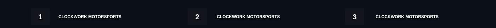
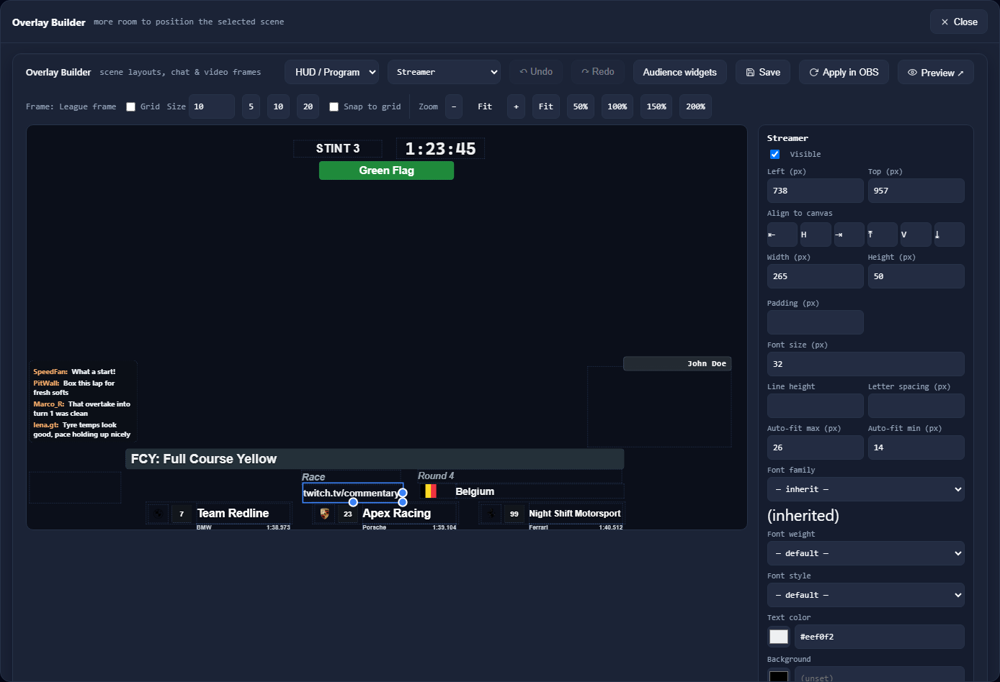
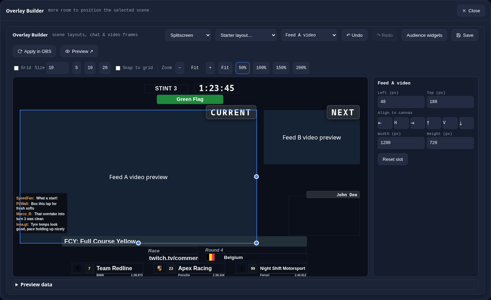
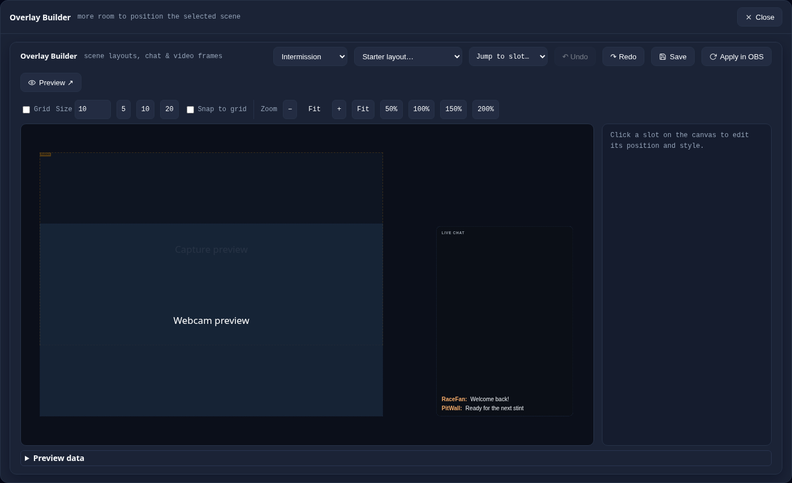
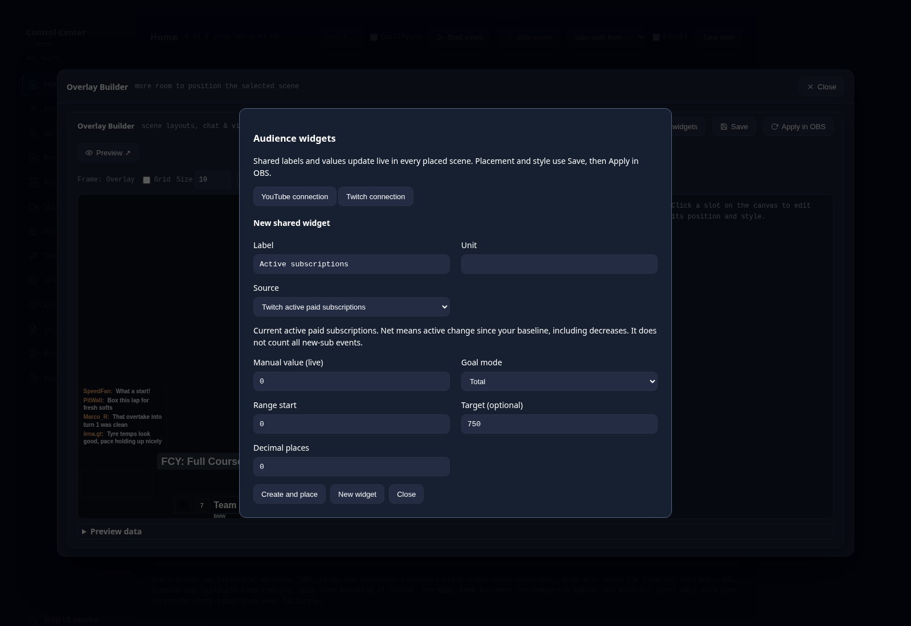
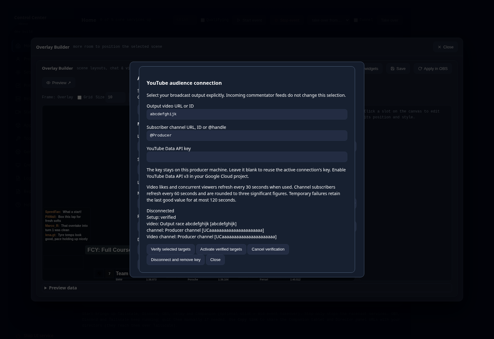
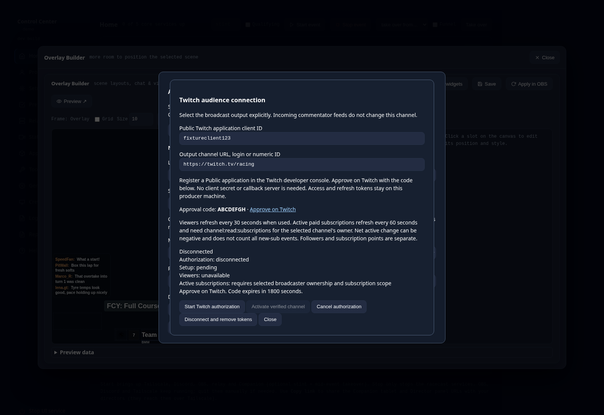
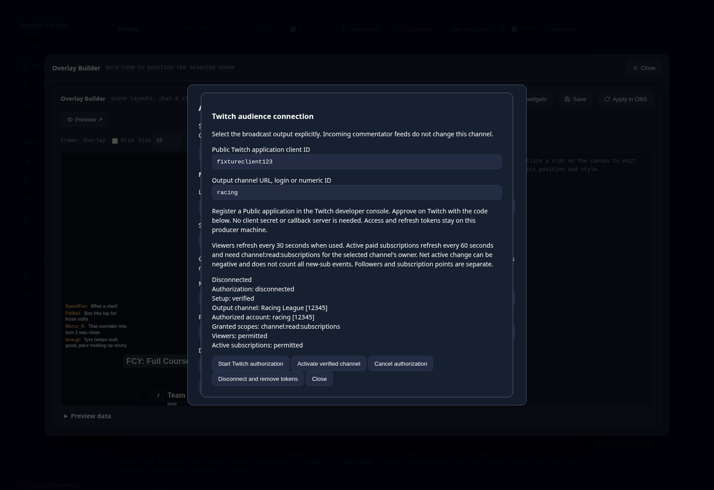

# HUD overlays

> New here? The visual [Overlay Package Designer deck ↗](https://jegr78.github.io/gt-racing-broadcast/overlay-designer.html) walks the builder + live preview; this page is the operator reference.

> Operator reference for restyling the on-screen HUD (including the race timer) per league.
> Profiles in general are covered in [League profiles](Profiles).

The relay serves the lower-third **HUD**, which **includes the race timer**, as one
shared page, the same `hud.html` for every league. A league can **restyle** it: reposition
elements, change fonts and colors: **without forking** the page, by shipping a small CSS
override (and optional fonts) in its profile.

Team names shrink between the slot's maximum and minimum font sizes to fit its
content width, including left, center and right alignment. Text that cannot fit at
the minimum remains clipped. The example below uses the same long name in all
three alignments.



Every other text box can fit the same way when the league opts in: set
**Auto-fit max (px)** and **Auto-fit min (px)** on the box in the overlay builder
(`--fit-max` / `--fit-min` in the page's CSS). This works on every page the builder
edits: the HUD, the Splitscreen labels and Split HUD, and the Intermission chat
panel. A long text then shrinks from max down to min whenever its content changes;
without an Auto-fit max the box keeps its fixed font size. The fit measures the width
of one line, so it suits single-line boxes (names, titles, labels). A hidden box keeps
its last size until it shows again. Picture and frame boxes (logos, flags, the POV
frame) have no font and no auto-fit.

Team names always fit and keep their own **Name max (px)** / **Name min (px)** pair
(defaults 30 / 16), so their box offers no separate Auto-fit pair.

## Where it lives

A league's overlay styling sits in its profile folder:

```
profiles/<name>/overlay/hud.css           # restyle the HUD (incl. the race timer)
profiles/<name>/overlay/intermission.css  # restyle the Intermission broadcast-chat panel
profiles/<name>/overlay/splitscreen.css   # independent Endurance feeds, labels and HUD
profiles/<name>/overlay/fonts/            # optional custom font files
```

`profiles/example/overlay/` ships as a commented template. All CSS files are **optional**:
an empty or missing file means the base look is used unchanged.

## How it works

The base `hud.html` and `intermission.html` stay shared. The relay serves the active
league's CSS at fixed paths:

- **`/hud/override.css`** ← `profiles/<name>/overlay/hud.css`
- **`/intermission/override.css`** ← `profiles/<name>/overlay/intermission.css`
- **`/splitscreen/override.css`** and **`/splitscreen/hud/override.css`** use the saved
  Split stylesheet; before its first save, the dedicated Split HUD inherits `hud.css`.

Each base page links its override **last** in `<head>`, so any rule in the league CSS
**wins the cascade** over the page's own styles. The CSS is read **per request**, so editor
saves apply without restarting the relay (with one first-time caveat below).

Custom fonts are served at **`/overlay/fonts/<file>`** from `profiles/<name>/overlay/fonts/`.
Reference them with a normal `@font-face`:

```css
@font-face { font-family: "League"; src: url(/overlay/fonts/League.woff2); }
```

## Overridable elements

The base HUD (`hud.html`, a 1920×1080 canvas, elements positioned from the top-left)
exposes these ids:

| Id | Element |
|---|---|
| `#stint` | the stint / label line |
| `#session` | the session line |
| `#streamer` | the commentator/streamer line |
| `#round-top` | the round header |
| `#round-flag` | the round country flag image |
| `#round-country` | the round country text |
| `#team1-…` `#team2-…` `#team3-…` | the three podium tiles, each is a group of independent slots: `-bar` (colour bar), `-logo` (brand logo image), `-num` (car number), `-name` (team name), `-brand` (brand/model text), `-quali` (qualifying best lap) |
| `#race-control` | the race-control line |
| `#clock` | the race-timer digits (merged into the HUD) |
| `#pov` | the POV picture-in-picture frame (position + background/border) |
| `#pov-name` | the POV on-screen name label (free text from the POV tab's `name` column) |

The POV box (frame + name) is shown only while the POV PiP is toggled on (driven by the
relay's `pov_shown`, via `/hud/data` `povActive`).

In a solo profile, `#webcam` (the webcam frame) and `#tyres-capture` (the tyres/fuel
crop box) also drive OBS sources: their box sets the position and size of **Solo Webcam**
and **Solo Tyres/Fuel Capture** in the Program scene, and hiding the slot
(`display: none`, or hiding it in the builder) hides that OBS source too, so the choice
travels with `profile export`. `racecast setup` writes it into the OBS import in both
directions: a hidden slot's source is hidden, any other is shown. A relay start, an event
start, `racecast obs refresh` and a backup restore only **hide** a source whose slot is
hidden; they never show one, so a webcam the director switched off on air (the panel's
`WEBCAM` key) stays off. `#pov` only places Feed POV; showing
and hiding it stays with the director's POV toggle.

## Team colours and qualifying lap

Three more overrides, all optional and driven by Sheet data rather than columns in the
table above:

| Id / hook | Fed by | Meaning |
|---|---|---|
| `#team1-bar` `#team2-bar` `#team3-bar` | — | An empty box behind each tile's logo/number; the base HUD ships it with no background, a profile paints one |
| `#team1-quali` `#team2-quali` `#team3-quali` | [Quali Times tab](Sheet-Template#quali-times-tab) | The car's qualifying best lap text |
| `--team-bg` / `--team-fg` | Configuration tab `BG Color` / `Text Color` | Set on **every** slot of a tile (not just `-bar`), so one CSS rule colors the whole tile |
| `body[data-mode="race"]` / `body[data-mode="qualifying"]` | the relay's live mode | Gate any rule on race vs. qualifying |

```css
#team1-bar, #team2-bar, #team3-bar { background: var(--team-bg, #000); }
body[data-mode="qualifying"] #team1-quali { display: none; }
```

**Always give `var()` a fallback.** When a colour cell is blank or rejected the HUD
removes the property entirely, so a bare `var(--team-bg)` becomes invalid and the bar
renders **fully transparent**, the tile loses its chrome instead of degrading to a
neutral. Blank is the normal state for every league that does not fill the columns.

These publish data, not a new control surface, no panel field, no Companion button. The
colours are static per league/team; the lap times are maintained once between qualifying
and the race: see [Sheet-Template](Sheet-Template#quali-times-tab).

## Editing: the visual builder

In the Control Center's **Profile** view, the **Overlay Builder** lays out every HUD slot
visually on one canvas: the lower third, the **race timer** clock and the **POV** frame
together: no CSS required. Click a slot to select it, drag it to reposition, drag the
corner/edge handles to resize, and set position, font, color, background (and, for the POV
box, border style/color/width) in the property panel. The fields **pre-fill** with each
slot's current template values, so you always see real numbers to adjust from. **Pop out ↗**
opens the builder in a larger modal over the Control Center; **Save** writes the files;
**Apply in OBS** reloads the browser source (the same as `racecast obs refresh`);
**Preview ↗** opens the live HUD preview at `/hud/preview` (the real base page with
live Sheet data over your `Overlay.png` frame).



### Splitscreen layouts

Endurance profiles also offer **Splitscreen** in the scene selector. Move and
resize **Feed A video** and **Feed B video** with the mouse or numeric bounds.
OBS fits each video inside its box while preserving its aspect ratio. The canvas
uses labeled placeholders and the profile's existing `Overlay.png` as a reference,
so you can design without feeds or OBS. Solo profiles keep their single-feed areas.

Each feed carries its own CURRENT/NEXT label. Select **Feed A label** or **Feed B
label** to style or hide it. **Right offset** moves a label left for positive values;
**Vertical offset** moves it down. Both start at zero relative to its existing
anchor. Moving or resizing a feed keeps that anchor at the feed's top-right edge.
The labels keep their usual slight overhang above the video.

Choose **Equal side by side** to restore the standard boxes, or **Large A +
secondary B** for an asymmetric starting point. Templates affect the draft and
support Undo. You choose the A/B geometry; CURRENT/NEXT updates change label text
and hide inactive NEXT, while retaining the chosen positions. Hiding a label
never hides its video.

The first edit copies your current HUD design and retains existing Splitscreen
CSS. **Save** writes `layout-splitscreen.json` and `splitscreen.css`; subsequent HUD
edits are independent. Existing label CSS stays verbatim and retains precedence
over generated styles. Its old top/right coordinates keep their meaning; the new
label offsets add to that anchor. The editor warns when advanced CSS overrides a
property. Profile export/import and Look backup/restore include the saved design.

**Apply in OBS** refreshes the two Splitscreen browser sources and updates only
that scene's A/B bounds, plus existing feed-cover bounds. It keeps the current
scene, feed visibility, ingest, handover state and audio routing. Stint and
Intermission keep their own layouts. Ordinary OBS refresh/startup also synchronizes
the saved Split geometry; the existing SPLIT live controls still own visibility
and audible commentary.

An older collection needs an updated import containing **Splitscreen HUD Overlay**
in the Split HUD group. Use Setup to export the updated collection, then import it
in OBS when appropriate for your production. Apply reports a missing browser/source
or disconnected OBS instead of claiming success. The additional browser shares the
existing race/timer data and introduces no extra video ingest. Before your first
Split save, it uses the existing HUD stylesheet to preserve the old appearance.



### Intermission layouts

Choose **Intermission** in the builder's scene selector. In Endurance, position,
resize, style or hide the public broadcast-chat panel over `Intermission.png`.
Solo POV and Solo commentary also offer **Webcam** and **Capture** frames. These
reuse the configured OBS sources; the editor displays labeled placeholders and
does not open the camera. Capture is below webcam, and chat stays above both.

Each scene has its own CSS and `layout-<page>.json`. Switching scenes preserves
unsaved drafts in the current browser session. **Save** persists only the selected
scene; HUD chat and Program video geometry stay independent. Existing
`intermission.css` imports into advanced CSS unchanged and keeps precedence over
the generated fields. Remove a conflicting advanced rule to let a field control it.

**Apply in OBS** applies saved Intermission video positions and visibility,
restores its saved chat visibility and refreshes its browser source. It does not switch scenes or change audio mutes.
Showing capture video does not unmute game audio. If OBS reports a missing source,
update/re-import the profile's scene collection. Automatic relay startup and
`racecast obs refresh` respect live visibility overrides and only hide video items;
they never reveal a camera an operator hid. **Preview** opens `/intermission` for a live chat check;
the complete video composition is visible in OBS.

Layouts travel with profile export/import and Look backups. Existing profiles
retain their appearance until edited: Solo POV initially shows webcam, Solo
commentary hides it, and capture starts hidden in both.



The **Starter layout** picker offers **Background + chat** and **Break + goals**
in both profile kinds. Solo also offers **Webcam + chat** and
**Capture + webcam + chat**. Selection changes editable slot geometry/visibility
only and supports Undo. It preserves fonts, advanced CSS, profile assets and goal
values. Save the result, then use **Apply in OBS**. A conflicting advanced CSS
rule still wins over a template's fields. **Break + goals** hides chat and video;
it also works as a plain background when no goals are configured.

The Director Panel's **Intermission** area and Companion's **BREAK** buttons
change live visibility separately from this design. These overrides survive
scene changes, browser reloads and relay restarts on the same producer machine,
until **Restore saved defaults** or an explicit layout Apply. They live in
`runtime/<profile>/intermission-live.json`, outside profile exports and Look
backups. OBS remains the truth for video, including manual OBS edits. Automatic
refresh never turns a source on; a live show override prevents a hidden design
default from turning that video off. After a manually hidden source, a saved live
show override does not turn it back on. Manual OBS changes appear immediately in
the panel; automatic refresh still honors the last relay override. Explicit restore may reveal a camera
enabled in the saved design. Disconnected/missing sources report unknown instead
of a guessed enabled state. Chat hiding leaves the browser's video frames intact.

The canvas renders the real base page with **sample data** over your league's
`Overlay.png` frame, so you position against the actual broadcast graphic. The per-slot
**font** dropdown (and a global body font) offers the league's own uploaded fonts plus the
machine-wide **font library** (see below); a profile-specific font can also be uploaded
under **Fonts & advanced CSS**, where **advanced CSS** is a raw escape hatch appended
verbatim after the generated rules.

### Fonts: a machine-wide library

A curated set of broadcast-friendly Google Fonts **ships with every install** and is
offered in the Overlay Builder's font pickers, no download step. To use a family that
is not in the set, type its name in **General Settings → Overlay fonts** (or open the
**Browse Google Fonts** link to find the exact name); it is self-hosted once into the
machine-wide library (`runtime/fonts/`) shared across all leagues, no per-league
re-download. When a league's design uses a font, it is copied into that league's
`overlay/fonts/` on save, so the overlay works offline and **profile export** stays
self-contained.

An update never replaces a font file that is already on disk, so it does not repair a
bundled font that an older version shipped broken (for example, missing Latin letters
and falling back to a serif). **Restore bundled fonts** in **General Settings → Overlay
fonts**, or `racecast fonts restore --force`, overwrites the bundled fonts in the
library and the same-named copies in every league's `overlay/fonts/`. Fonts you added
under a name the bundle does not use stay untouched. Afterwards run `racecast obs
refresh` so OBS reloads them.

How it round-trips: the builder owns a `layout-<page>.json` model and **compiles** it into
the same `profiles/<name>/overlay/<page>.css` the relay serves, so everything below about
the cascade still holds. A profile's existing **hand-written** `<page>.css` is imported
verbatim into the advanced-CSS box the first time you open the builder (nothing is lost),
and your visual changes compile **above** it.

The relay keeps the profile's overlay path even before the first Save creates
the directory. Save and **Apply in OBS** therefore work on a new profile without
a relay restart.

> **CLI alternative:** edit `profiles/<name>/overlay/hud.css` in any text editor,
> drop fonts in `profiles/<name>/overlay/fonts/`, then `racecast obs refresh`. (Editing the
> CSS by hand and using the visual builder on the same profile both work, the builder
> imports your hand-written CSS into its advanced-CSS box, then owns the generated file.)

## Example `hud.css`

```css
/* Move the stint line and restyle race control */
#stint        { left: 800px; top: 30px; font-size: 44px; }
#race-control { background: #222a2f; }

/* Custom font (drop the file in overlay/fonts/ first) */
@font-face { font-family: "League"; src: url(/overlay/fonts/League.woff2); }
html, body { font-family: "League", "Arial Narrow", sans-serif; }
```

## OBS collection naming

Per-league overlay styling pairs naturally with a per-league OBS scene collection. The
naming convention is **`GT Racing Endurance: <league>`** (set via the profile's
`OBS_COLLECTION`); switch OBS to it with `racecast obs collection set`. See
[League profiles](Profiles) and [OBS & scenes](OBS-Setup).

---

> This page is generated from `src/docs/wiki/` in the
> [main repository](https://github.com/jegr78/gt-racing-broadcast): don't edit it
> here by hand. See [Build & maintenance](Build-and-maintenance).

## Audience counters and goals

Open **Profile → Overlay Builder → Audience widgets**. Create a named manual
counter, optionally with a unit, range start, target and decimal places. For
example, use `Community challenge`, value `18`, unit `hours`, target `24`.
Manual widgets work without a platform account or Google Sheet.



Creating a widget places it in the current scene draft. Select it on the canvas
or in **Jump to slot** to choose **Number**, **Number with target** or **Labeled
progress bar**, then adjust its position, size, font, colors, border and number /
percentage visibility. Use **Save**, then **Apply in OBS** to activate the saved
placement and style. The Intermission builder works in Solo and Endurance;
Splitscreen is available in Endurance.

To reuse a value, select another scene and choose **Audience widgets → Place in
this scene** beside the existing widget. Each placement has its own design.
**Remove from this scene** edits that scene's draft and retains the shared
widget. **Delete shared widget** removes its definition for every scene; the
confirmation lists saved placements. Shared deletion hides existing live widgets
immediately. Undo covers scene design changes, not shared live data edits.

**Manual value (live)**, label, unit, target and formatting edits update all
already placed live widgets without a browser reload. They do not move the
placements. Builder preview fields are samples and never change these live
values. A newly placed widget needs Save and Apply before it appears on air.

A **Total** reset sets the manual value to its range start. **Net since captured
baseline** requires an explicit **Capture baseline / reset** action. It keeps the
raw manual value and target, and displays the change since that captured value.
Reloading a browser or restarting the relay never captures a new baseline.
Reaching a target does not raise the target or reset a value. Values above the
target remain visible; the bar stops at 100%. Without a target, the widget shows
its number and hides the target, bar and percentage.

Automatic platform values use the same data contract; connection and fetching
are handled by the platform integrations. Unknown or unavailable values are
never shown as zero. A transiently stale last-good automatic value can remain
visible for at most 120 seconds after its last successful update. It then hides,
including when the relay cannot be reached. Manual values retain their last
known value when the relay is briefly unavailable.

Shared definitions, manual values and captured baselines are stored in
`profiles/<name>/audience.json`. A **profile export/import** carries them to
another machine. A **Look backup/restore** restores scene designs only, so it
cannot rewind a live value or resurrect a deleted shared widget. Producer
handover does not transfer this local file automatically; transfer the profile
bundle when the receiving producer needs the same audience state. Credentials
for platform connections belong to machine runtime state, outside this
file and Look backups.


### YouTube output metrics

In **Audience widgets**, choose a source: **YouTube video likes**, **YouTube
concurrent viewers** or **YouTube channel subscribers**. Manual widgets continue
to work without a connection. The builder shows sample values, including the
approximate marker for rounded subscribers.

Open **YouTube connection** while the relay is running for the active profile.
Enable **YouTube Data API v3** in your Google Cloud project and enter its API key.
This reads public video/channel counts; you do not need to log in with a Google
account or provide a client secret. Keep API restrictions compatible with the
producer's local application and network.

Paste a concrete output video ID or URL for likes/viewers. For subscribers,
select a channel ID, channel URL or `@handle` separately. The video and subscriber
channel are explicit choices; incoming commentator feeds never change them.
A channel's dynamic `/live` shortcut is not a concrete video selection.

Choose **Verify selected targets**, check the resolved titles and IDs, then
**Activate verified targets**. The dialog shows the video owner and subscriber
channel separately, plus cached availability and errors per metric. Editing a
verified target or key requires verification again. Verification alone keeps the
current connection.
**Cancel verification** discards the candidate. A candidate expires after five
minutes. Leave the key field blank to reuse the current local key when changing
targets. **Disconnect and remove key** hides automatic values immediately and
removes the local key. Storage failures appear as errors; if disconnection cannot
be saved, fix permissions and retry before restarting the relay. A failed activation
keeps the verified candidate in RAM; retry activation after fixing storage without
re-entering the key or repeating verification before the candidate expires.



Only metrics used by saved widget definitions are polled. One relay request reads
video likes and concurrent viewers every 30 seconds; channel subscribers refresh
every 60 seconds. Opening more browser sources or reading connection status does
not add provider requests. Quota/rate errors back off. A transient failure can
hold a last-good automatic value for at most 120 seconds from its successful
observation. The value then hides, including when the relay is unavailable.
Invalid authorization, disconnect, changed targets and missing/hidden counts hide
values immediately. A real zero remains visible.

Concurrent viewers are available only while the selected broadcast is live.
Upcoming, ended and inaccessible broadcasts have no viewer count, even if an old
API field remains. Likes can remain available after the broadcast ends. YouTube
public subscriber counts are rounded to three significant figures and display
`≈`. They do not support exact net goals. Video likes support **Net since
captured baseline** after **Capture baseline / reset** deliberately captures a
fresh exact cached value. A stale, missing or approximate value cannot become a
baseline. Restarting does not recapture it.

Public targets live in `profiles/<name>/audience-youtube.json` and travel with a
profile export. The API key stays in that producer's runtime profile directory;
profile bundles and Look backups exclude it. An imported profile retains its
selected output but requires a local key and verification on the receiving
machine. Look restore does not rewind targets, credentials or captured baselines.

### Twitch output metrics

Choose **Twitch concurrent viewers** or **Twitch active paid subscriptions** in
**Audience widgets**. Open **Twitch connection** with the relay running for the
active profile. In the [Twitch developer console](https://dev.twitch.tv/console),
register an application with client type **Public**, then enter its client ID.
The ID is public. Do not enter a client secret. This desktop flow uses Twitch's
hosted activation page and does not start a local callback server.

Enter the output channel URL, login or numeric channel ID. A numeric login can
be entered with `@`, for example `@123`. This selection stays fixed when
Endurance switches input feeds. Choose **Start Twitch authorization**, open
**Approve on Twitch**, and enter the displayed approval code. Approve access
with the account that owns the selected channel to enable subscription totals.
The only requested scope is `channel:read:subscriptions`.



Check the resolved **Output channel**, **Authorized account** and **Granted
scopes**. The dialog shows whether each metric is permitted. Choose **Activate
verified channel** explicitly. Approval alone preserves the active connection.
Editing the client ID or channel requires authorization again. **Cancel
authorization** discards the candidate. Codes expire according to Twitch's
approval lifetime; a verified candidate expires after five minutes or when its
authorization expires, whichever comes first.



Viewers refresh every 30 seconds and active subscriptions every 60 seconds when
used by saved widgets. Additional browser sources and status reads share the
relay cache. An offline channel has no live viewer value. A live stream reporting
zero viewers displays zero. Missing subscription scope or authorization for a
different broadcaster leaves viewers usable and subscriptions unavailable.
Anonymous public chat, capture and feed ingest need no new OAuth connection.

The subscription metric is the endpoint's active paid subscription **total**,
including funded subscription types as reported by Twitch. It is neither the
length of one results page nor subscription points or followers. **Net since
captured baseline** measures active change, including decreases when existing
subscriptions lapse. It does not count all new-sub events during the session.
Choose **Capture baseline / reset** to record a fresh exact cached total; stale
or missing data cannot become a baseline. Reconnect and restart preserve source
identity and do not recapture the baseline. Changing the target channel requires
a new baseline.

Rate limits and temporary failures back off. A last-good transiently stale value
hides at its original 120-second deadline. Offline, missing permission, revoked
authorization and disconnect hide affected values immediately. Tokens are
validated on startup and at least hourly, including when no widget is using
Twitch. Expired tokens can rotate locally. Interrupted or ambiguous one-use token
exchanges require authorization again. If saving a new pair fails, the relay
retries local storage without reusing the consumed refresh token. Fix reported
storage errors before restarting.

**Disconnect and remove tokens** immediately disables Twitch values and removes
local credentials without resetting manual goals. Durable cleanup failures are
reported; fix permissions and retry. Public client ID and target selection live
in `profiles/<name>/audience-twitch.json` and travel with profile bundles. Tokens
stay in the producer's runtime profile directory and are excluded from profile
exports and Look backups. An imported profile requires authorization on its new
producer machine. Look restore cannot rewind targets, credentials or baselines.
