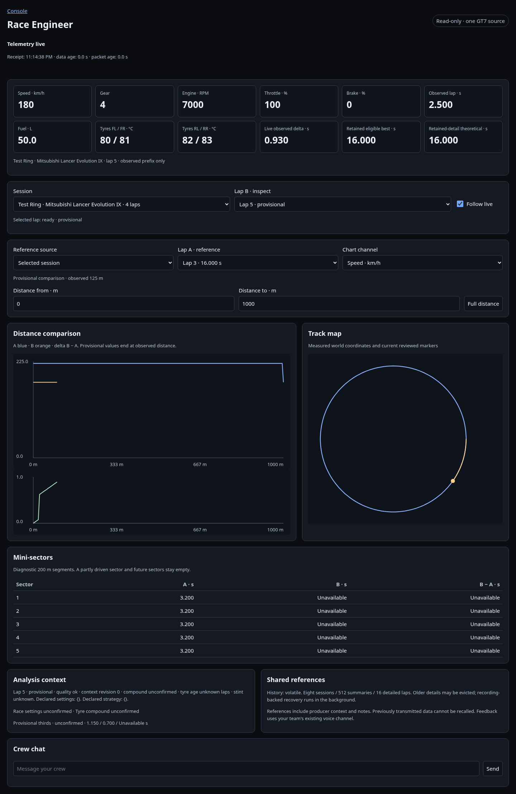
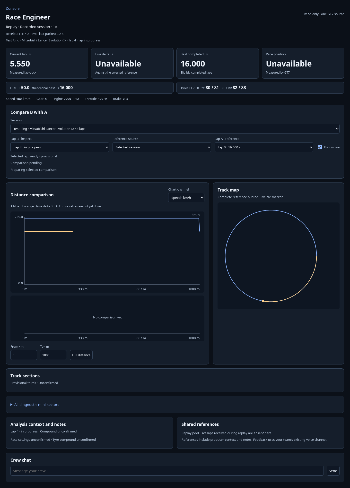
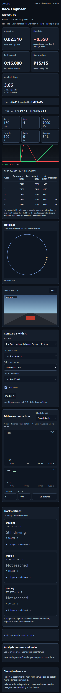

# Race Engineer

Open **Console → Race Engineer** with your existing signed link or Discord login.
The producer enables **Allow Race Engineer** in the local Telemetry view. Assign the
additive Race Engineer Crew checkbox to each Engineer; Producers inherit access.
Directors, Commentators and Race Control require that explicit checkbox. Redeploy
the current Sheet webhook when adding the Crew field.

## Live values and analysis

The producer can replay a profile recording through the running relay. The desk
then reads **Replay · Recorded session and capture date · speed×** and receives the same source as
the broadcast HUD. It exposes a display label, never the producer's filename.

Every switch starts a separate pool, including stop and end of file. Live laps
driven during replay are absent from the live pool. With recording enabled their
details remain recoverable from the recording through the existing shared-reference
workflow. Without recording, those laps are lost. The desk states this limitation.

Current lap, live delta, best completed time and race position lead the desk.
Fuel, theoretical best and tyres follow, with compact speed/gear/RPM/pedal values.
Select the comparison before inspecting the charts; channel and distance controls
are attached to the chart. One line below the selection reports the comparison:
the distance the delta covers, the lap time difference, or why none is shown yet.
The delta tile names the distance it covers, the best tile names its lap. A loss
carries a **+** sign, so gain and loss do not depend on color.

The desk reads the existing single GT7 source of a solo POV profile. Speed, gear,
RPM, throttle/brake, race position, observed lap time, fuel and tyre temperatures refresh roughly
twice per second. Missing measurements say **Unavailable**, without their unit. The observed lap clock
and live delta describe received data; neither advances without new packets.
Race position reads **P15/15**, for example, from GT7's own-car position and field
size. Missing or inconsistent readings remain unavailable. Completed lap options
include the position measured at the line when GT7 provided it. No gaps to
other cars are inferred. Receipt time (24-hour) and age of the last telemetry packet remain
visible. During a replay the line shows the recorded time in UTC instead.

Select **Session** and **Lap B** to inspect retained current or prior-session laps.
Sessions show the track, vehicle name and lap count; unknown names fall back to
the car ID. Shared session and reference-lap options include the producer's label.
Select an eligible **Lap A** from the selected session, or choose a producer-shared
**Reference source**. Without a choice, the desk takes the fastest eligible lap with the
same car and track, or from the same session while the track is unknown. While lap B is
an out lap, pit lap or first lap of a stint, or while its track is still being
recognised in the first lap of a session, it chooses none and says so; a chosen
reference stays selected. The charts use the same validated distance stations, sector
and context rules as the local Control Center. Blue is A, orange is B, delta is
B minus A. The current lap is provisional; future curve sections and incomplete
200 m sectors say **Not yet driven** in muted text. Missing measurements remain
**Unavailable**, and untimed lap zero reads **Out lap**. Confirmed best and theoretical values exclude it.
While the lap grows, comparison retains the latest completed observed prefix and
refreshes it in the background. Its displayed distance identifies that prefix.
The map uses the complete selected reference lap as its outline, or the latest
confirmed session lap when no reference is available. Its outline and full-distance
chart range stay stable while the live trace grows, including during preparation.
The displayed best uses retained eligible summaries. The theoretical value uses
the retained detailed pool, not an unlimited full-session archive.

Change the chart channel or distance limits to inspect braking, throttle, speed,
steering or gear. **Full distance** resets zoom. The map uses measured world
coordinates. The car marker comes from the latest measured snapshot, independently of
the selected lap endpoint. Missing coordinates and unrelated historical tracks
do not show a current car. Reviewed larger sections show named A/B times and gain or loss in separate groups
when both laps use the same confirmed definition. Expand each group to inspect its
diagnostic mini-sectors, or open the full diagnostic table below. A segment that
spans a section boundary appears in both affected groups; each section gain uses
its exact reviewed boundaries. Each group shows its distance range and the number
of its mini-sectors. On a lap in progress, the group the car is in says **Still driving**
and later groups say **Not reached**. Unconfirmed definitions retain their status.
A short trailing mini-sector is grouped with its predecessor for display; shared
analysis values are unchanged. Curves show their channel units, delta has a zero
line, and an empty comparison has a message, retains known distance and omits artificial axes. Turn labels
sit on the complete reference outline, also ahead of the car, avoid overlaps and have a textual legend. Declared settings and strategy use named
values rather than raw JSON. When the producer's relay has no track recognition data yet, the
desk says so next to **Unknown track**. Unknown tracks compare only within the same source and session; known
car, compound or strategy contradictions prevent the default comparison.

**Follow live** selects the newest active lap. Manually choosing a session or lap
turns it off. While it is off, new completed-lap notifications continue without
changing your chosen lap or zoom. Following live again or selecting the newest
current/completed lap clears the notice. Each browser has its own selection. Producer context revisions,
shared notes and limitations update without resetting that selection.

## Connection, history and access

Pause, menu, loading, preparation delay, stale telemetry and browser disconnection
have distinct labels. Five seconds without packets dims retained values. A browser
connection interruption keeps selection and zoom while it retries. A relay restart, and a
replay starting or ending, starts a new generation and clears the live selection and zoom.
The notice names which of them happened. A selected shared reference stays selected. Explicitly
shared recordings remain selectable historical sources and never replace live values.

Collection starts with the profile opt-in and incoming packets, without waiting for
an Engineer browser and without starting permanent recording. Without recording,
history is volatile and disappears on relay restart. Memory retains at most eight
sessions, 512 summaries and sixteen detailed completed laps totaling at most
16 MiB, plus the protected current lap. Older session details go first, then the
oldest current-session details. **Evicted**, **pending** and **unavailable** detail
states are visible. Matching recorded detail is recovered locally in the background
once for all readers; discarded summaries no longer supply selectable live IDs.

The producer shares finalized reference recordings and context explicitly from
**Telemetry → Race Engineer access**, using a readable label. Engineers cannot
browse the archive. Revocation, deletion or source replacement clears a selected
reference with a notice. Role removal or disabling the profile opt-in clears the
protected desk and stops further polling. Already transmitted browser data cannot
be recalled. Reload after the producer restores access.

The desk cannot start recording, edit context, assign tracks, delete, export or
download full recordings, invoke AI or change broadcast controls. Use existing
**Crew chat** and your team's voice channel for feedback. No driver-message channel,
shared Engineer notes, video monitor or extra driver ingestion is added.

## Smaller screens

Desktop and tablet place the charts beside the map. Smartphone stacks them while
keeping comparison feedback, source/lap selection, channel/zoom controls and
reviewed section summaries available. Its main values use two columns. Context,
notes, shared references and Crew chat follow the analysis on every screen.

See [Control Center activation and sharing](Control-Center#race-engineer-activation-and-reference-sharing)
and the [Console access mechanism](Console#race-engineer-access).
