# Telemetry workspace

Run `racecast telemetry ui`, or choose **Open Telemetry workspace** in the Control
Center. This local-only workspace reuses the UI service. `racecast --profile NAME
telemetry ui` opens a specific archive without switching the broadcast profile.
Closing the browser leaves background work running; **Stop UI service** disconnects
both local interfaces and requires acknowledgement of an active AI analysis.

## Tasks

- **Archive** starts with recordings and an entry to the last comparison. Import a
  local `.gt7rec` path here. In-progress captures remain protected from analysis/deletion.
- **Analysis** shows reference A and analysed lap B in wide, aligned traces. Set a
  distance window for all charts; the distance slider also works with keyboard arrows.
  The numbered track map stays beside the graphs, follows the selected distance and retains that position when you move away. **Sectors & markers** opens the timing detail below the graphs. **Notes & context** opens
  recording annotations. Analysis profile selection never changes broadcast selection.
- **Reports** shows saved AI runs, validated findings and exports. Links reopen the exact
  analysis profile and verify the recording identity.
- **Data management** holds context preparation/templates, shared track/sector editing,
  external vehicle references, CSV export and machine AI settings. CSV export writes
  beside the selected recording and displays the destination.

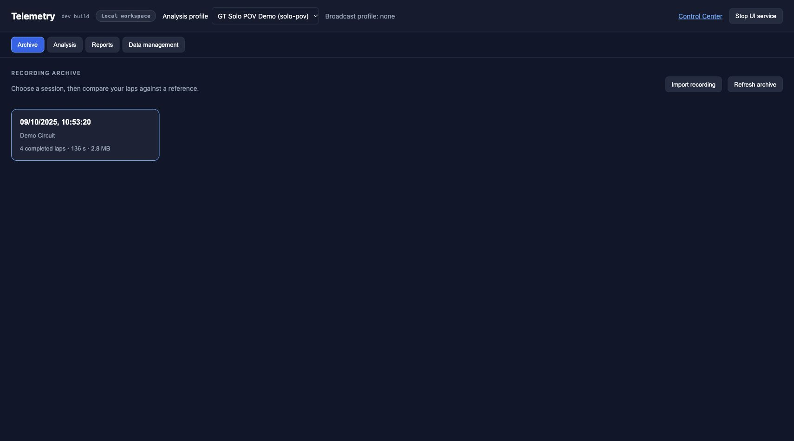

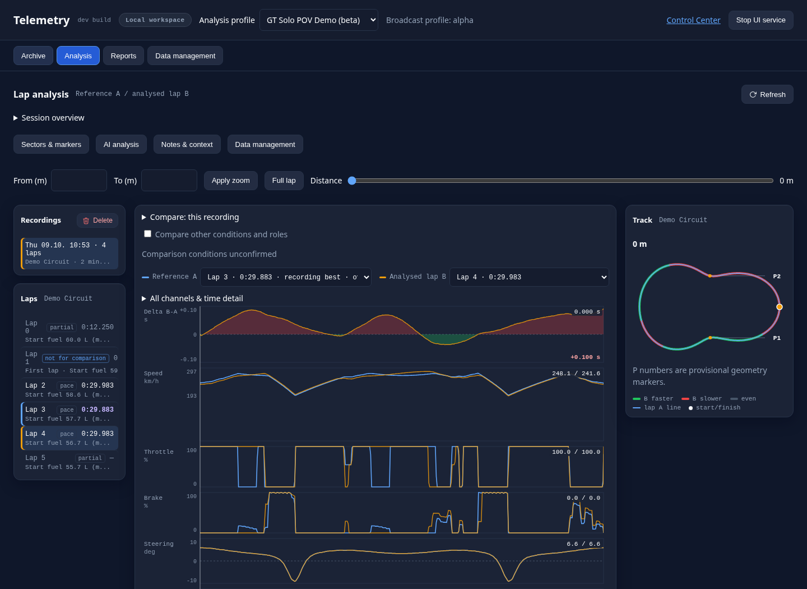

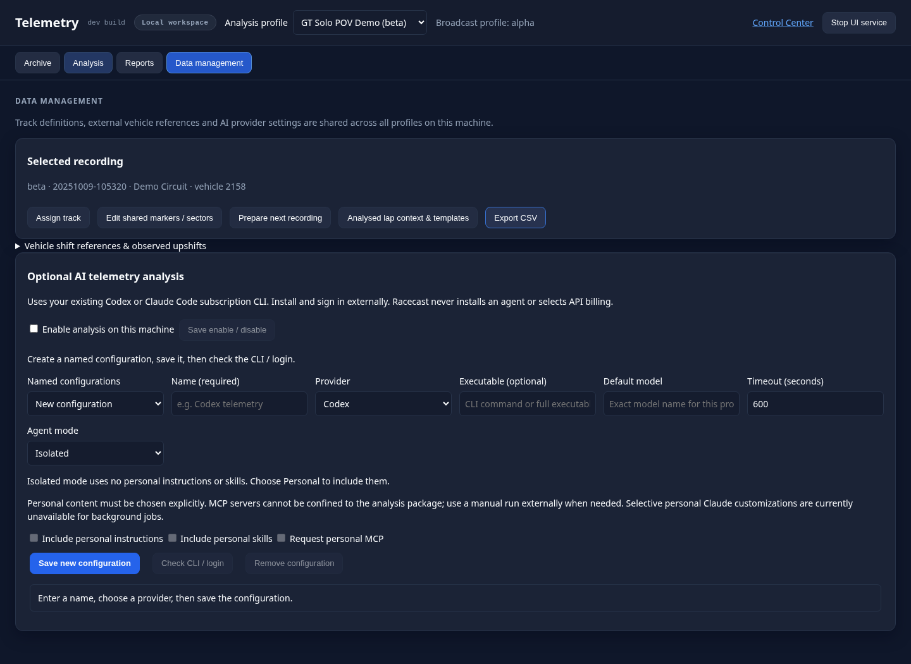

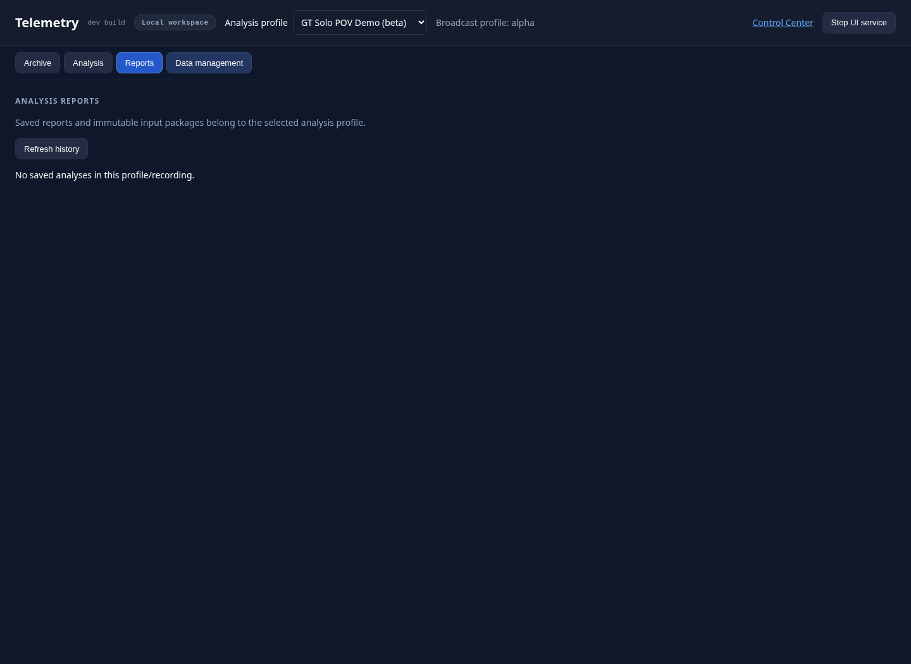

Archive work and AI need no running relay. Live reception/recording and broadcast
replay remain relay-owned; remote users continue using the read-only
[Race Engineer Desk](Race-Engineer).

Recordings, notes/context and AI histories belong to the selected profile/source.
Track/sector definitions, external vehicle reference caches and AI provider settings
are shared across profiles on this machine and labelled accordingly. Setup-specific
shift targets remain recording/profile context snapshots.

## Existing analysis and data contracts

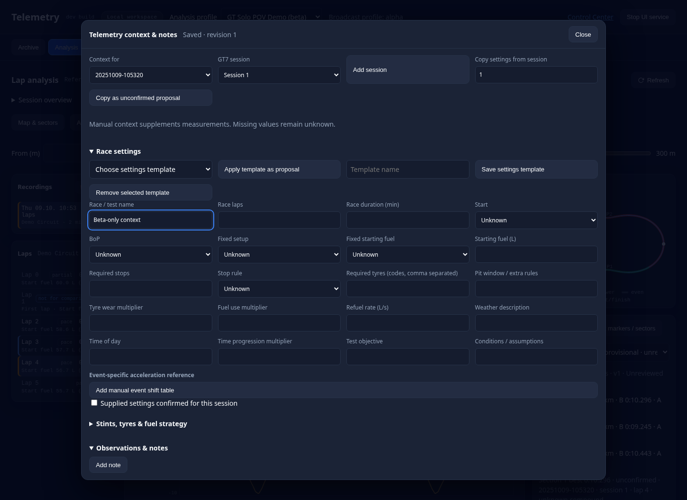

Direct links to Archive, Analysis, Reports and Data management keep their task
on reload. Switching the analysis profile returns to Archive.

The workspace reads the selected analysis profile's GT7 telemetry recordings
(`runtime/<profile>/telemetry-recordings/`, see [Relay mode](Relay-Mode)) and needs no
running relay.

- **Summary.** Above the comparison, the figures of the post-event report for the picked
  recording, one block per track and car: best lap, theoretical best, consistency
  (standard deviation of the counted lap times), fuel per lap, counted laps, the average
  tyre temperatures and the lap-time trend in driving order (the best lap green, laps that
  were not counted grey). Click a dot in the trend to make that lap lap B.
- **Recordings and laps.** Pick a recording, newest first, to list its laps with time.
  Duration comes from the first and last complete stored packet, so copying or
  importing a recording does not change it. Listing scans record headers without
  decoding telemetry or rebuilding indexes; unchanged files reuse a bounded cache.
  Recording labels show weekday, date, start time and lap count; hover for the file stem.
  **Compare: this recording** above the charts opens a scrollable list of recordings
  with the same track and car. Only the selected recording is included by default.
  Use **All recordings**, **Only this recording**, or the checkboxes to change the pool.
  This choice lasts for the page visit. Lap A/B are grouped by recording, in driving
  order, with separate recording-best and overall-best labels. Excluded recordings
  contribute to neither picker nor the comparison's Best column or theoretical sums.
  If there is no other counted lap in the selection, lap A stays empty.
  `ref` marks a lap that was the fastest so far when it was driven (the live HUD delta ran
  against it), `not counted` a rejected lap with the reason below it. The fastest counted
  lap is purple, lap A carries an orange bar and lap B a blue one. A lap names its car or
  track only when it differs from the rest of the recording. The first
  open shows "Indexing…" while the view runs the index job, the same as `racecast
  telemetry index`: it replays the recording once and caches the result next to it as
  `<stem>.laps.json`. Later opens are instant until the recording or the GT7 track data
  changes. A recording the job cannot read shows the job's reason instead of its laps.
  The recording the relay is still writing shows as `(recording)` and cannot be picked:
  it stays out of every comparison, and the view analyses it only after the recording
  stops.
- **Delete a recording.** **Delete** on the Recordings card removes the selected
  recording, its context and context history, CSV export, lap index, recording-owned AI analyses and their input packages after a confirmation, the same as
  `racecast telemetry delete <name>`. It cannot be undone. The recording the relay is
  still writing cannot be deleted: stop the recording first. While an AI analysis is
  active, cancel it or wait before deleting recordings. Shared machine agent settings
  remain available. Reference snapshots already frozen in another recording's report
  stay with that report and become stale if their source disappears.

  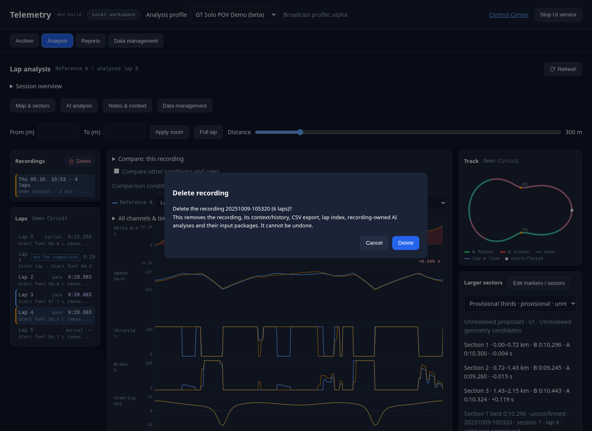

- **Context & notes.** Add race settings, per-session confirmations, stints, fuel maps,
  intentional shortshifting and notes before, during or after capture. The context editor
  can select an active recording even while its lap analysis is unavailable. Recording
  notes apply to the whole file; session and lap notes keep their own scope. Hover a chart
  before opening the editor to attach that position to a note for the selected lap.
  Valid edits save automatically; unfinished numeric inputs remain drafts. Concurrent
  edits report a conflict and retain your local draft. Earlier whole-context revisions
  can be restored as a new revision. Measurements and raw capture bytes remain unchanged.
- **Prepare next recording and templates.** Preparation attaches once to the next capture.
  Templates copy settings into the selected session as an unconfirmed proposal; changing
  a template does not change existing recordings. Copying another session also requires
  fresh confirmation and does not carry over its stint boundaries. Missing values remain
  unknown. Templates and preparation belong to the profile.
- **Stint service and comparison.** Enter the lap and optional recording time at which
  service occurred. Temperature resets, refuelling and standstill produce proposed times,
  never confirmed tyre compounds. A pit lap can contain both RM and RH. Each confirmed
  tyre change has a configurable number of complete warmup laps (including zero).
  Each lap shows its measured starting fuel load and the number of lap boundaries since
  the declared initial stint or last confirmed tyre change. This tyre-age proxy includes
  a partial service lap and does not establish prior wear at capture start or a wear percentage.
  It does not assume equal conditions. Default
  comparisons exclude contextual first, pit and warmup laps, mixed known fuel strategies within a lap, different confirmed
  compounds and known differences in race settings or fuel strategy. **Compare other
  conditions / roles** explicitly broadens the pool; numerical quality checks still apply.
  Unknown context remains inspectable and is labelled unconfirmed. Reports group known
  compounds, conditions and strategies separately.
- **Capture and pace.** Every recorded segment remains selectable, including the
  partial segment before the first lap and the unfinished segment after the last lap.
  An unfinished segment shows captured seconds, not an invented completed lap time.
  Capture completeness, distance-trace coverage and pace eligibility are separate.
  For a known layout, a full lap must cover the reference length within the track
  match tolerance and begin near start/finish before its trace is normalized.
  A capture joined farther into the lap remains partial and cannot establish a
  pace reference. Older cached indexes rebuild with this coverage check.
  Both `reference` and `counted` admit a regular lap; **best so far** marks a historical
  live reference, not a stronger data-quality verdict. Pit laps show all detected
  reasons. **After inferred service; tyres unconfirmed** identifies the next lap without
  claiming a confirmed tyre change or warmup period.
- **Lap clock.** Complete pace traces include the closing boundary sample. Their entire
  receiver-clock interval is normalized to the matched GT7 lap duration, beginning at
  zero and ending at that duration. This prevents a backwards final sector when receiver
  timing differs from GT7. Raw packet times and GT7 lap times are preserved; this is a
  reconciled comparison clock, not a claim that every network arrival was a simulation tick.
- **Lap A and lap B.** Lap B is the lap you click. Lap A starts as the fastest counted
  lap other than B with the same track and car across all recordings of the profile.
  Both pickers list every comparable counted lap; B also shows the clicked lap when it
  is not counted. When B has no such partner, lap A
  reads "no other lap to compare" and the charts show B alone. Laps on an unknown track
  compare only within their GT7 session. When other recordings have no cached laps yet,
  for example after a Set track, the view runs the index job first ("Indexing
  N recordings…"). No request rebuilds the full recording index: loading a lap or
  setting a track on a recording without cached laps also waits for that job.
- **Charts.** Speed, throttle, brake, steering, gear and the delta of B against A over
  lap distance, each with its value range on the left. Below zero B is ahead, above zero
  behind; the delta panel ends with the final gap. Hover to read both laps at one point;
  the map shows where that point is.
- **All channels & time detail.** Open this section and select up to eight values,
  including constants, clutch/gearbox data and simulator flags. Distance is the default
  comparison axis. A time window spans at most 30 seconds and reads each retained
  original packet, preserving short cuts and stationary service events. Time windows
  use receiver-clock seconds from the recorded lap boundary; distance views retain
  the indexed lap's clock and common reference geometry. Partial and rejected laps
  retain their receiver-clock label. Missing timing coverage stays unavailable.
  Select **Load window** after changing the channels or bounds. Each chart reports
  units, source offset, packet/derived provenance, constant values and counts of
  available, missing, unset and nonfinite values. Flags and discrete values use steps.
- **Raw diagnostics.** The separate checkbox offers uncertain fields and flag meanings.
  Hover shows the native interpretation and original bytes at the cursor. These values
  have no claimed physical units or validated sensor meaning. Quaternion components
  are dimensionless; RPM display-alert thresholds are separate from a confirmed rev limit.
  GT7 may report constant simulation values, including temperatures; a constant value
  does not establish a changing real sensor measurement.

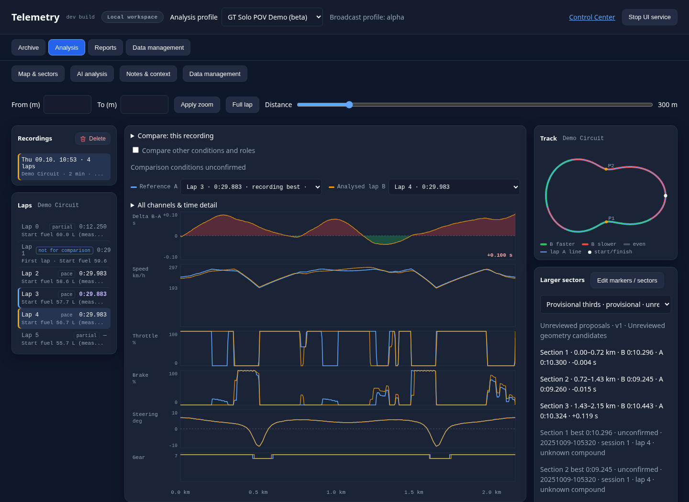

- **Vehicle shift references & observed upshifts.** The selected lap's GT7 car ID resolves
  a local reference. **Update external reference for this car** explicitly downloads
  source curves, ratios and revbar data into machine-local runtime. Ordinary lookup is
  offline and an update failure preserves the previous cache. Unsupported or malformed
  data show unavailable components. External curves and code are not bundled.
- **Shift references by car.** In **Data management**, search a car by name, maker or
  GT7 ID and fetch or refresh its reference without a recording of it, for example
  before the first session in a new car. **Show local entries** lists every car with a
  machine-local entry, its update time and which components the source supplied. The
  [Race Engineer desk](Race-Engineer) reads the same local entries.
- **Acceleration reference.** The independent piecewise-linear calculation compares
  normalized power before and after the adjacent ratio change at equal road speed.
  It assumes full throttle, sufficient grip and instantaneous shifts. Decoded gearbox
  ratios take precedence over stock source ratios. A range-capped target is partial,
  not a confirmed rev limit. Matching ratios do not confirm the power shape for an event.
  Power and torque are each independently normalized to a maximum of 100, not physical
  HP, kW or Nm. The curve endpoint, display alerts, source revbar and separately
  confirmed rev limit have distinct labels. Source commit, SHA-256, fetch date and
  calculation method remain available; the source supplies no per-curve measurement
  date, GT7 revision or fuel-consumption map.
- **Recorded phases.** The table uses original time packets. It infers pre-cut RPM
  from stable drive/cut samples and post RPM from the engaged new-gear bracket.
  The last old-gear packet can already be cut. Capture gaps, skipped gears and neutral
  bridges retain explicit missing/ambiguous phases. Comparisons are for observed
  upshifts; early shifts can be intentional for fuel saving, traction or cornering.
  Acceleration and manually entered stint economy targets have separate neutral RPM
  deviations. A power lookup does not establish an optimum fuel-saving target.
- **Manual event table.** Add an event-specific acceleration table in **Context & notes**,
  or copy locally calculated targets into an unconfirmed event table. Record vehicle,
  intended configuration and provenance, then confirm session and table applicability
  separately. Templates retain the reference while requiring new session confirmation.
  Updates never replace these manual values. Confirming a table does not confirm a
  separately displayed external curve. Reports and CSV exports freeze reference values,
  provenance and phase observations; later updates do not rewrite saved outputs.

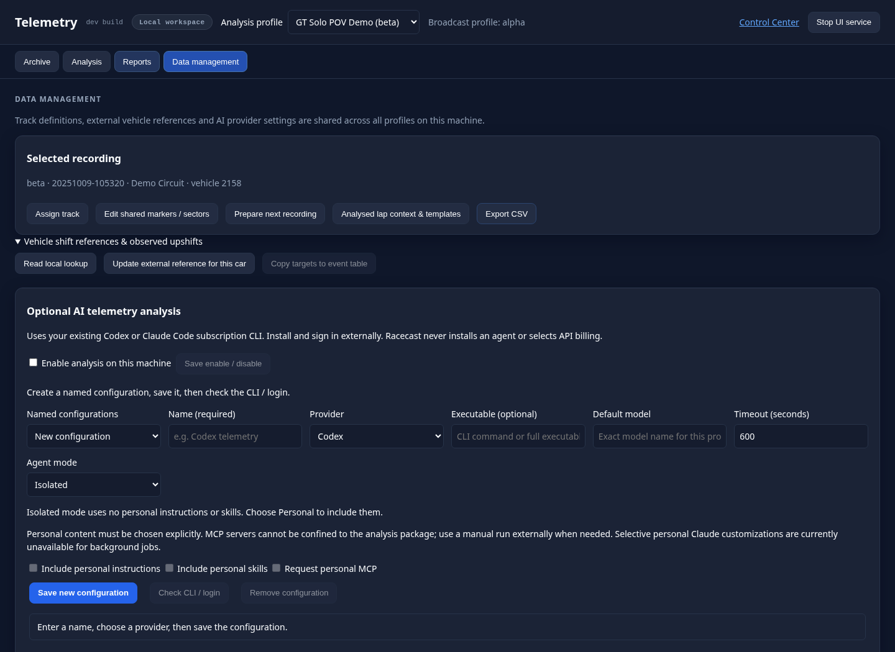

The illustration uses authored synthetic reference values; no external curve is bundled.

- **Track map and mini-sectors.** Lap A is the thin line; lap B is split into 200 m
  mini-sectors, green where B is faster and red where it is slower (the legend under the
  map). The table lists every mini-sector with its distance, the times of A and B, the gap
  and the best time of any comparable lap (purple where B set it); its last row
  adds a diagnostic mini-sector sum. When the comparable laps
  end at different lengths, as on an unknown track, the last mini-sector's best and the
  diagnostic sum show `—`, the same rule as the post-event report.
- **Corners and larger sectors.** Reviewed markers have stable identities and show
  turn numbers on the map. Grand Valley uses the publisher's 19 numbered corners;
  the catalogue's count of 18 stays visible as a different source. Its supplied three
  coaching sections are reviewed divisions, not verified GT7 timing splits. Other
  layouts offer visibly unreviewed geometry proposals. Nominal track length and
  reference-line distance are separate measurements.
- **Edit track markers.** Open the map editor to edit turn number, name, direction
  and entry/anchor/exit world coordinates, or click the map to move the selected
  anchor. Add corners, connected combinations and named sector variants with any
  supported number of boundaries. Changes remain drafts until **Apply shared
  definition**. Definitions are shared across profiles on this machine; overrides
  remain separate from the supplied base. A stale edit requires reloading.
- **Prepare a layout before recording.** In **Data management**, open **Track
  definitions without a recording**, choose a downloaded layout and driving direction,
  then **Edit shared definition**. The downloaded reference racing line supplies the
  map and unreviewed proposals; check turn numbers, anchors and sectors manually.
  Apply saves the shared definition for later recordings and analyses. Learned layouts
  still need a recorded lap. If the list is empty, run `racecast gt7-data update` and
  refresh layouts. A changed reference line or a newer saved revision requires reloading.
- **Sector definition.** Select a named division for this session. Verified reviewed
  game splits take precedence by default when available; an explicit choice is kept.
  Larger-sector bests show their source recording, session, lap and compound. A
  confirmed ideal composition requires complete eligible timing, reviewed boundaries
  and confirmed comparable conditions. Missing context or provisional divisions show
  an unconfirmed sum. Entry speed across sector boundaries can prevent achieving the
  composed time in one lap. Reports and exports retain the definition/version used;
  later edits do not move spatial notes or rewrite saved outputs.

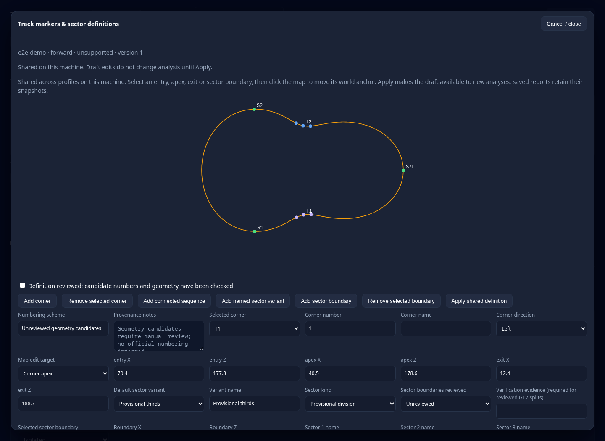

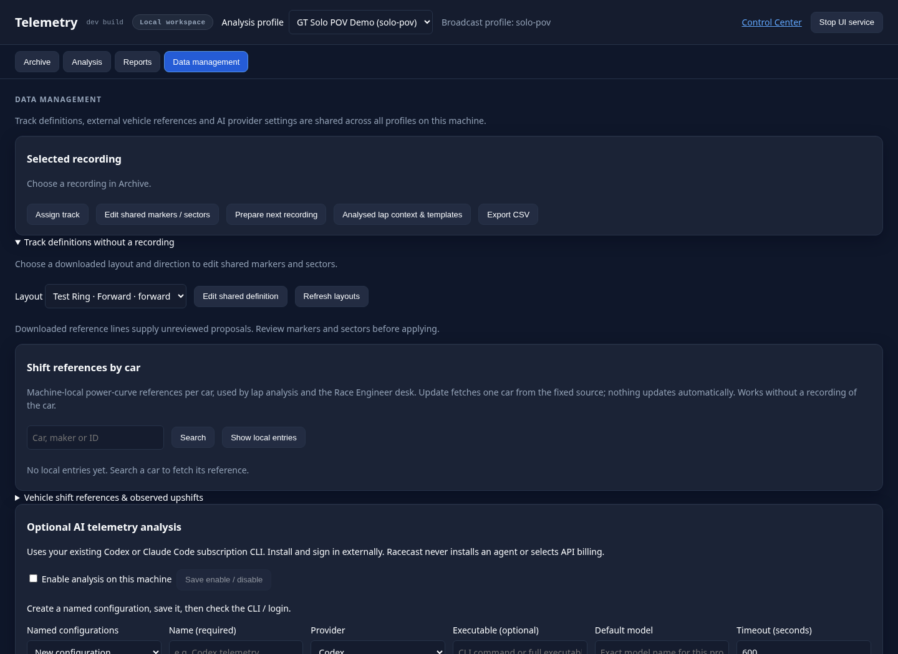

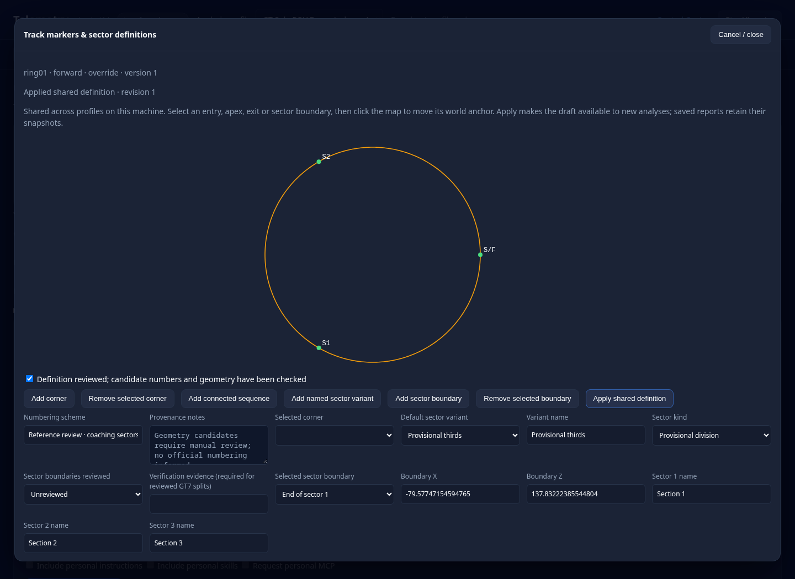
- **Set track.** When racecast does not recognise the layout of a GT7 session, or two
  layouts fit, pick it from the list. The row acts on the session of the analysed lap B
  and names it ("Session 5"), because one recording often holds several tracks; it is
  hidden while lap B's session has a known layout. racecast assigns that session to the
  layout. For a layout with a downloaded racing line, or the reverse of one, that is
  all. For any other layout racecast also learns the line from the session's longest
  counted lap, so later recordings on it are recognised. A downloaded racing line always
  takes precedence over a learned one. The note under the button says which of the two
  happened. A recording without laps offers the row for the recording as a whole.

The racing lines are not part of the package. Until racecast has downloaded them
(`racecast gt7-data update`, or an explicitly enabled relay-start update), it recognises
only layouts learned with Set track, and every other recording starts as track unknown.
Some layouts have no downloadable racing line at all (the upstream data drops captures
that do not close into a lap, for example Autopolis Short Course); those are recognised
only after a Set track. When a counted lap matches no layout, the relay log says so once
per session: `GT7 track: no match for a <length> m lap`.

> **CLI alternative:** `racecast telemetry export <name>` writes laps/channels CSV,
> `sectors.csv`, and current `context.json` and `track-definitions.json` snapshots
> excluding drafts and revision history;
> `racecast telemetry index` builds the missing lap caches ahead of time.

### Optional AI telemetry analysis

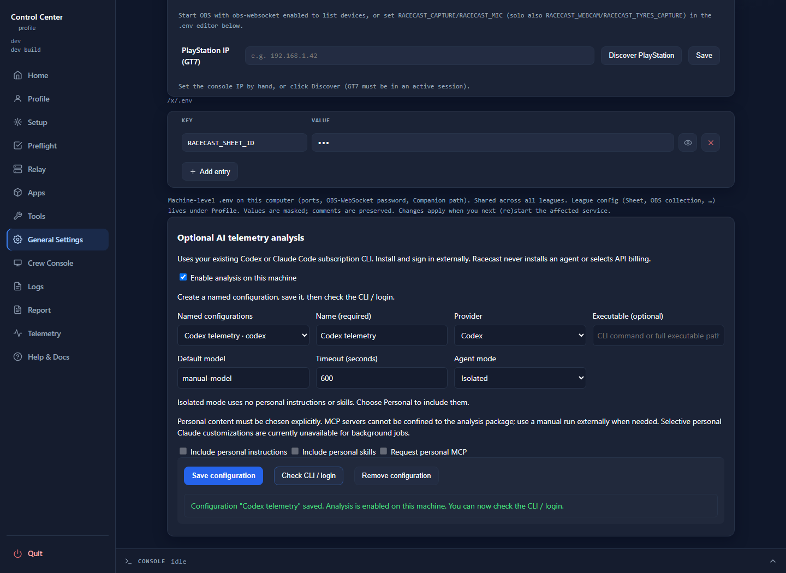

AI analysis is disabled by default. Ordinary telemetry, charts and comparisons work
without either provider CLI. In **Data management**, enable the feature and save
one or more named Codex or Claude Code configurations. Choose the executable if it
is not on PATH, a default model, timeout and agent mode. **Check CLI / login** probes
the installed tool and existing subscription login without model inference. Model
suggestions use the installed Codex catalogue. Claude Code offers the documented
`sonnet`, `opus` and `haiku` aliases immediately. Their resolved versions depend on
the CLI and account settings; enter a full model ID to pin a version. Suggestions
do not select a model automatically or verify account access.

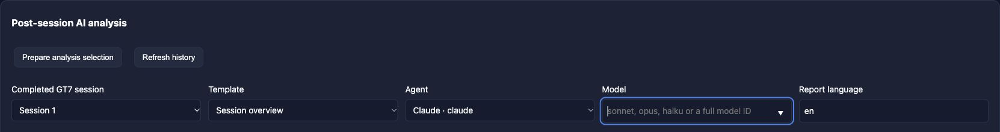
The same provider can have multiple configurations.

For a new configuration, enter a name and click **Save new configuration**.
To save only the machine-wide enable switch, click **Save enable / disable**
next to the checkbox. This also works without configurations and preserves
unsaved configuration edits.
The message below the buttons confirms the saved name or explains a save error.
Edits show **Unsaved changes**; **Check CLI / login** becomes available after saving.
In **Isolated** mode, personal instructions and skills are disabled. To include
them with Codex, choose **Personal** and select each option explicitly. Personal
MCP and selective Claude customizations are unavailable for background analysis.
Model suggestions belong to the checked configuration. Changing the provider
clears the draft model so a Codex model is not carried into a Claude configuration.

Install and sign in with the provider's own tools before using Racecast:
[Codex authentication](https://developers.openai.com/codex/auth/) and
[Claude Code authentication](https://code.claude.com/docs/en/authentication).
Racecast stores configuration, not provider credentials. It never installs agents,
changes login, silently selects another model or falls back to API billing.
A ready CLI does not guarantee subscription quota or access to a selected model.
On macOS, subscription credentials in the GUI keychain can be unavailable to an
SSH session. Use the authenticated local desktop session for the provider CLI.
Provider checks use the OS user running Racecast; a login under another OS user
does not sign in this process.

Windows Codex background runs require the MXC sandbox and unified command
execution, verified with CLI 0.162.1. Racecast requires MXC explicitly and never
falls back to administrative sandbox setup. If MXC is unavailable, use a supported
Windows environment, choose Claude explicitly, or export the package for a scoped
manual run. Runtime environment paths are preserved; profile/API secrets are not
passed to model commands.

**Isolated** is the default mode. The job can read the prepared package and write
its dedicated output, with no blanket approval bypass. **Personal** permits
explicitly selected instructions or skills only where the adapter can preserve
isolation. Personal content may add information beyond the telemetry preview.
Background MCP use is refused because external servers cannot be confined to the
package. Selective Claude customizations currently require a manual external run.
Interactive approval requirements stop the background job with manual-run guidance.

In **Telemetry**, open a recording and choose **Prepare analysis selection**.
Select one completed GT7 session and the completed laps to inspect. Technically
unusable laps show exclusion reasons. Choose **Session overview**, **Driving
technique** or **Consistency**, an agent/model, goals/questions and report language.
Reference suggestions are unchecked until you choose them explicitly. Your own
session best is a valid reference; without an external reference the package does
not establish an ideal line or optimal braking points. Context confirmation, car,
layout, tyres, settings and objective constrain comparisons. Unknown tracks cannot
support cross-recording comparisons.

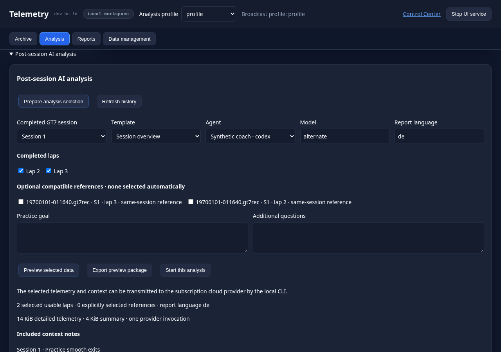

Choose **Preview selected data** to inspect included notes, selected/reference
laps, data sizes and quality/comparability limitations. A local CLI process can send
these selected inputs to the provider's cloud models. Read that disclosure before
**Start this analysis**. Changing the selection, model, context or profile requires
a new preview. An oversized package requires fewer laps/references or shorter notes.
**Export preview package** downloads the four input files without invoking a model.
Stopping a recording never starts analysis automatically.

One job can run on the machine, across the UI and `racecast telemetry analyze`.
The status card above the selection shows package preparation, provider execution,
evidence validation and the final result. Running jobs show provider, model and
elapsed time without an invented completion percentage. Reopening the workspace
reconnects to an active job. Reference choices are grouped by recording and
collapsed; package notes, lap context and limitations expand separately.

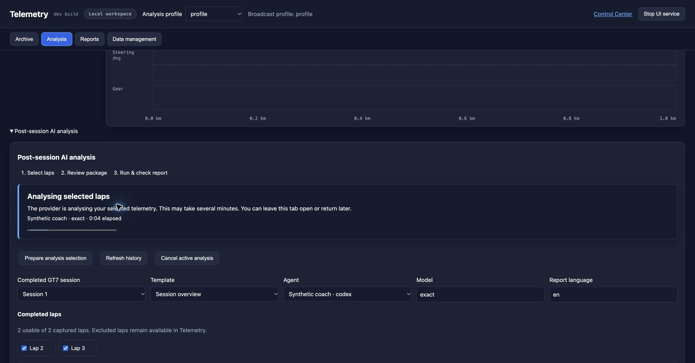
The default timeout is ten minutes and is configurable per agent. Progress and
**Cancel active analysis** operate on the spawned process tree. Cancellation cannot
recover quota already consumed. There are no automatic retries or repair calls.
CLI, login, model, quota, approval, timeout and validation failures show guidance.
Failed reports expose bounded local logs under **Technical details**. A report
that fails evidence validation is never displayed as a verified result.

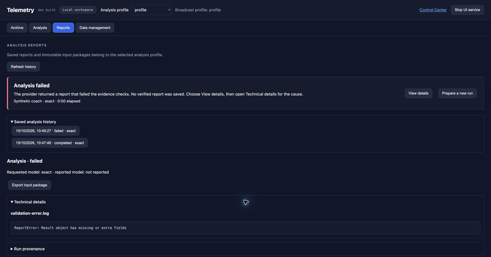
Choose **Prepare a new run** to deliberately inspect and start another package.

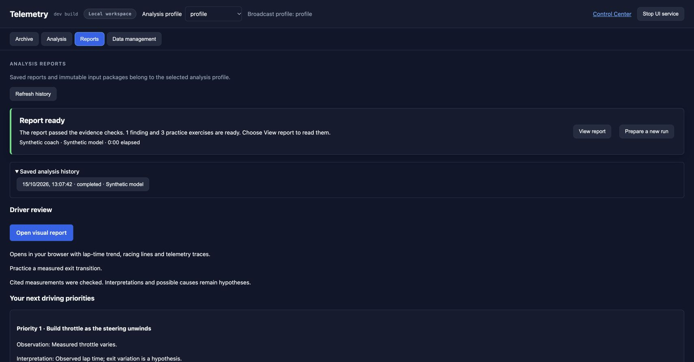

A completed report displays supplied facts with provenance and separates measured
observations from interpretations and possible causes. New reports contain up to
five focused findings and up to three optional exercises; empty sections are omitted.
Telemetry links open the referenced lap and metre position in the existing
comparison view. Saved history is scoped to the analysis profile/recording; switching
profiles clears the displayed selection and artifacts. Relevant source/context or
reference changes mark an old report stale without altering its original inputs.
Failed, cancelled or interrupted jobs retain diagnostics and input packages but
never show a normal report. Each run retains its report language, requested model,
actual model when reported, provider/config identity and versions.

Export a completed report as HTML or Markdown, or export its input package
separately. HTML links require the Telemetry workspace at the recorded local address
and the explicit analysis profile in the link. Recording deletion removes its owned analyses
and input packages after the existing confirmation; machine agent settings remain.
Private recordings and provider credentials are excluded from automated fixtures.

### Visual driver reports

Completed AI analyses offer **Open visual report**, which opens a profile-scoped
HTML page directly in your browser. It includes a lap-time trend, measured racing
lines and distance-aligned speed, throttle, brake input and steering charts where
the saved package contains those channels. Technical notes and provenance expand
on demand. Explicit downloads remain under **Exports and technical details**.
New reports support English and German throughout the report. Older reports keep
their original findings and frozen input; channels absent from an older package
are shown as unavailable. Each new finding separates observation, interpretation,
a practice attempt and a measurable check. Comparison differences are not promises
of recoverable time.

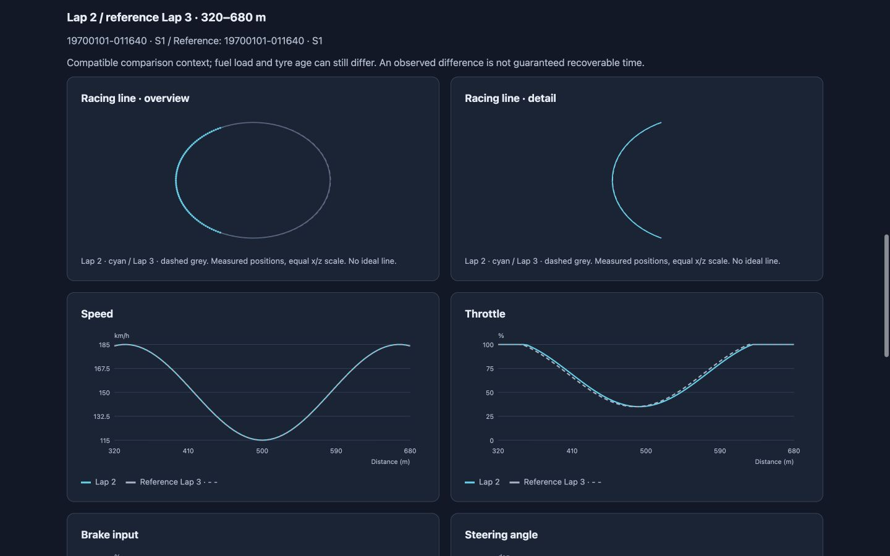

Turn numbers in report maps and the workspace use the saved marker definitions.
`T` identifies reviewed turns; `P` identifies provisional geometry proposals.
Passages show the turn number and metre position together. Missing numbering is
stated explicitly. On smaller screens the map moves above the charts. The shared
marker editor retains its numbered world anchors.

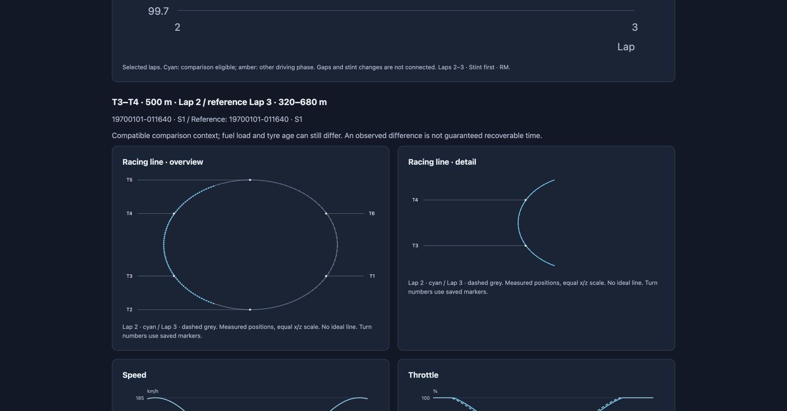
